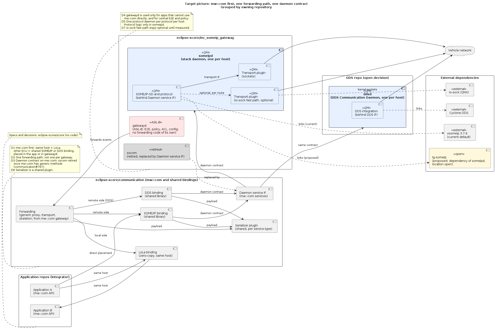

<!-- ----------------------------------------------------------------------------
  Copyright (c) 2026 Contributors to the Eclipse Foundation

  See the NOTICE file(s) distributed with this work for additional
  information regarding copyright ownership.

  This program and the accompanying materials are made available under the
  terms of the Apache License Version 2.0 which is available at
  https://www.apache.org/licenses/LICENSE-2.0

  SPDX-License-Identifier: Apache-2.0
----------------------------------------------------------------------------- -->

# DR-010-arch: Target architecture for SOME/IP and DDS on mw::com

- **Date:** 2026-11-17

```{dec_rec} Target architecture for SOME/IP and DDS on mw::com
:id: dec_rec__arch__target_someip_dds_on_mwcom
:status: draft
:version: 1
:tracking: TBD
:context: SOME/IP and DDS support is split across three repositories with two gateway forwarding paths, a socom layer that duplicates mw::com, and a prototype that bypasses both. S-CORE needs one target picture for the communication stack.
:decision: Applications use mw::com only. Same-host communication uses LoLa. Remote communication uses SOME/IP or DDS bindings shipped in communication, placed in the application or in gatewayd. One stack daemon per protocol per host holds the wire protocol. Forwarding exists once, in communication. socom is retired in favour of mw::com services.
```

---

## Context / Problem

S-CORE applications use `mw::com` as their service-oriented API. LoLa provides
zero-copy shared-memory communication on the same host. Remote communication
needs a SOME/IP binding (for ECUs running SOME/IP) and, per DR-009, a DDS
binding (for DDS domains).

Today the implementation is spread over three repositories and does not yet
form one picture:

- **`eclipse-score/communication`** holds the `mw::com` core. Its SOME/IP
  binding is a skeleton without a transport: service discovery returns
  `kInvalidBindingInformation` with TODOs, and event sending returns
  `kBindingFailure` ("unsupported without a transport"). The binding list is a
  closed enum (`BindingType`) and the runtime factory creates runtimes from a
  fixed list, so a new binding requires a code change and a rebuild. It also
  contains a LoLa-to-LoLa gateway (`score/mw/com/gateway`) that forwards events
  between domains with a `GenericProxy`, a `Transport` interface and a
  `GenericSkeleton` on the destination side.
- **`eclipse-score/inc_someip_gateway`** holds `gatewayd` (ASIL-B),
  `someipd` (QM), `socom`, `gateway_ipc_binding` and a serializer. The
  `gateway_ipc_binding` package forwards events across the `gatewayd`/`someipd`
  process boundary with the same `GenericProxy`/`GenericSkeleton` pattern as the
  communication gateway. `socom` is documented as intra-process only; it is
  bridged across processes by `gateway_ipc_binding`. The forwarding pattern and
  the service model are therefore implemented twice. `gatewayd` does not yet
  implement E2E protection; the code has only comments.
- **Prototype** (`communication/experimental/someip_sd`) adds an SD-only daemon,
  a custom control protocol over `score::message_passing`, and an io-sock kernel
  module that moves SOME/IP event payloads outside the daemon. The module is
  declared QM, has no E2E, runs the LoLa runtime inside the io-sock process, and
  cannot be unloaded.

The gateway is still in active use and is the only place where ASIL-B
processing is planned. The gap is not a missing gateway; it is that the
gateway duplicates forwarding and a service model that `mw::com` already
provides, and that the stack and binding boundaries are not defined.

Methods are not covered by the current `mw::com` generic proxy and skeleton
(events only). `socom` is the only layer in the gateway that supports methods
today, and generic methods in `mw::com` are not scheduled
(`eclipse-score/communication#767`).

## Decision

S-CORE adopts the following target architecture for SOME/IP and DDS on
`mw::com`. The component view is shown below and the source is kept next to
this record as `_assets/DR-010-arch-target_component.puml`.



**D1 — `mw::com` first.** Applications use the `mw::com` API only. Applications
on the same host communicate through the LoLa binding. Applications on another
ECU communicate through a SOME/IP or DDS binding. The binding runs either in the
application (direct placement) or in `gatewayd` (gateway placement).

**D2 — One forwarding path.** Forwarding between a local `mw::com` service and a
remote binding is implemented once, in `communication`, generalised from the
existing LoLa gateway. The forwarding code in `gateway_ipc_binding` is retired.

**D3 — `socom` is retired.** The daemon contract between a binding and a stack
daemon is defined as `mw::com` services (the daemon service interface). `socom`
is removed once `mw::com` provides generic methods. Until then, methods are the
only blocking item.

**D4 — `gatewayd` has a narrow role.** `gatewayd` is used for applications that
cannot use `mw::com` directly (legacy LoLa applications, native DDS peers) and
for functions that need an ASIL-B host: E2E protection, policy and access
control. `gatewayd` contains no forwarding code of its own.

**D5 — One stack daemon per protocol per host.** `someipd` holds the SOME/IP
protocol and service discovery. `ddsd` holds the DDS participant and DDS
transport. Protocol logic lives only in these daemons. The bindings in
`communication` talk to a daemon through the daemon service interface and never
link a protocol stack.

**D6 — The serializer is a shared plugin.** A serializer plugin interface per
service type is used by all bindings and by `gatewayd`. A null serializer passes
pre-serialized payloads through unchanged. The location of the implementation
is decided in a follow-up record.

**D7 — The io-sock fast path is optional.** A kernel-side transport can be added
as a transport plugin of `someipd`, behind the same interface. It is not part
of any ASIL data path. It is enabled only if a measurement shows a material gain
over the daemon path on target hardware.

The following are not part of the target:

- a kernel module in an ASIL data path;
- an `mw::com` runtime inside a kernel module or inside the io-sock process;
- a second SOME/IP daemon, or a second SOME/IP stack in applications;
- a new gateway repository.

The choice of SOME/IP stack for `someipd` (vsomeip, which is the current
default, or lg-someip) is not decided here. It is decided on measurements
described in the plan that accompanies this record. The location of the stack
source (dependency or in-tree) is decided with it.

## Backwards Compatibility

The SOME/IP gateway has no released product. The SOME/IP gateway feature
page states that there is no previous gateway solution in S-CORE, so no
backwards compatibility is required for it. `socom` is internal to the gateway
repository and is not an application-facing API: `socom` appears only in
`gatewayd`, `someipd`, `gateway_ipc_binding` and `bridged_services`.

Applications are not affected. They continue to use `mw::com`, and their
deployment configuration changes only when a SOME/IP or DDS route is added.

In `communication`, the changes are additive: binding registration without a
core change, generic methods, and a shared forwarding path. The existing LoLa
gateway keeps its behaviour and is generalised rather than replaced.

## Alternatives Considered

**Keep `socom` and finish the migration in progress** (`inc_someip_gateway#358`,
open PRs #322, #409, #417, #421). This keeps two service models and two
forwarding paths. Rejected because it keeps the duplication this record removes.

**Keep the current split** (`socom` over `gateway_ipc_binding` over `mw::com`).
This works today, but the duplication stays and the binding is not usable by
applications directly. Rejected.

**`mw::com` only, without `gatewayd`.** Not sufficient: legacy LoLa applications,
native DDS peers, policy and access control, and ASIL-side E2E placement need an
ASIL-B host. Rejected as the whole answer; kept as the default path (D1).

**A separate SOME/IP daemon per application** (the daemon-less stack used in
the opensomeip comparison). This gives the lowest latency for small messages,
but each application then holds its own SD, ports and event fan-out, and port
sharing across services is not provided. Rejected for the host-wide
coordination the target needs; the measured latency gain is recorded as an
input to the stack decision.

**The io-sock kernel module as the main SOME/IP data path.** Rejected: the
module runs the LoLa runtime inside a QM system process, has no E2E, cannot be
unloaded, and its benefit has been measured only against its own user-space
stand-in on QEMU. It remains an optional transport (D7).

## Rationale

The target puts each concern in one place. The wire protocol and the network
stack are in the daemon, which is QM. The binding code is in `communication`,
which is the `mw::com` repository and holds no network stack. The ASIL-B logic
is in `gatewayd`. A QM stack and an ASIL-B consumer therefore never share a
process, which is the freedom-from-interference boundary the feature
requirements already require.

It removes the two duplicated mechanisms that the repositories currently
implement: forwarding and the service model. Each of these is already provided
by `mw::com`, so the target reuses it instead of re-implementing it.

It keeps the LoLa binding as the zero-copy path on one host, and does not claim
zero-copy across the network: the network path always copies, and the zero-copy
benefit is limited to the local `mw::com` path.

The choices that depend on data (the stack, the fast path, the serializer
location) are deferred to follow-up records, so this record does not depend on
numbers that have not yet been measured on target hardware.

## Consequences

Work products that change:

| Work product | Repository | Change |
|---|---|---|
| Binding registration | `communication` | Bindings can be registered without a change to the `mw::com` core |
| Generic methods | `communication` | Required before `socom` is removed (`communication#767`) |
| Forwarding | `communication` | One path, generalised from the LoLa gateway |
| Serializer plugin interface | `communication` | Shared by all bindings and `gatewayd` |
| Daemon service interface | `communication` | `mw::com` services, replacing the `socom` contract |
| SOME/IP binding | `communication` | Gets a transport through the daemon service interface |
| `someipd` | `inc_someip_gateway` | Offers the daemon service interface; uses the chosen stack |
| `gatewayd` | `inc_someip_gateway` | E2E protection implemented; no forwarding code of its own |
| `socom` | `inc_someip_gateway` | Retired |
| `gateway_ipc_binding` forwarding | `inc_someip_gateway` | Replaced by the shared forwarding path |
| DR-001 | `inc_someip_gateway` | Status changed to superseded by this record |
| Prototype | `communication` | Moved into the target components or removed |
| DDS daemon | DDS repository (to be decided) | `ddsd` with the DDS binding in `communication` |

Follow-up records that are needed:

1. SOME/IP stack for `someipd`, and the location of the stack source.
2. io-sock fast path (after the measurements in the plan).
3. Serializer implementation location, shared with DDS.
4. Repository for the DDS daemon.

Open work that must be re-scoped: `inc_someip_gateway#358` (the migration
sequence, which keeps a reduced `socom`) and the open `socom` PRs #322, #409,
#417 and #421. Their scope should follow this record once it is accepted.

Verification: the plan's tests T1 to T8 apply, in particular TC8 conformance,
the multi-application host test, and fault injection on the QM/ASIL boundary.

## Rejected Ideas

- A kernel module in an ASIL data path. Rejected: it is not a safety mechanism
  and it places `mw::com` in a QM system process.
- A separate SOME/IP daemon per application. Rejected for the reasons in
  Alternatives Considered.
- A new gateway repository for SOME/IP. Rejected: the gateway stays in
  `inc_someip_gateway` and the shared parts move to `communication`.
