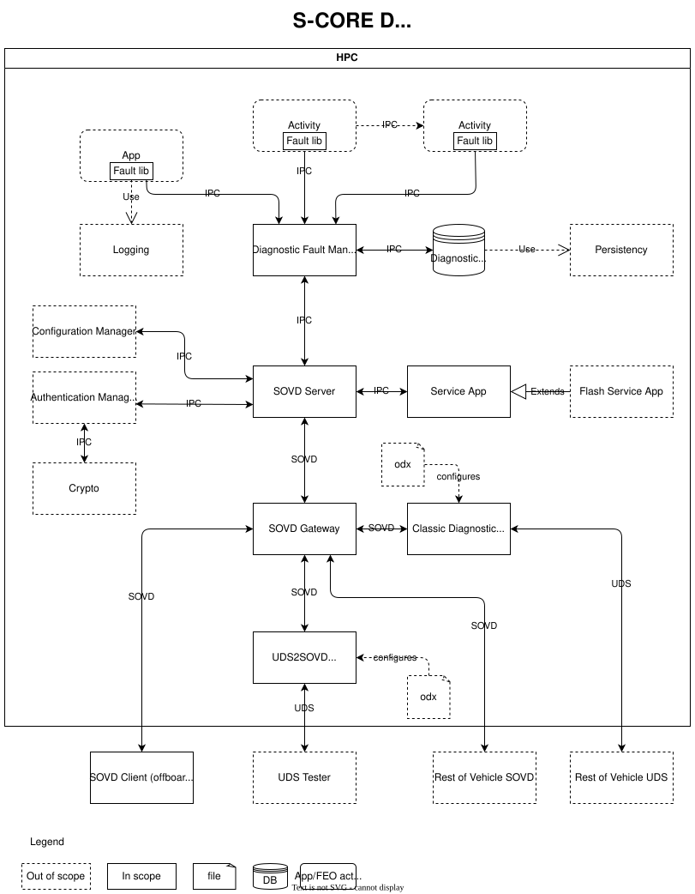
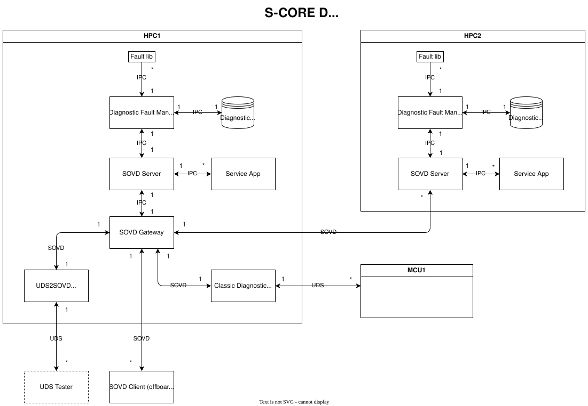
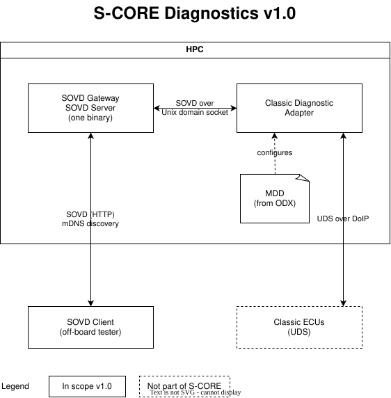

..
   # *******************************************************************************
   # Copyright (c) 2025 Contributors to the Eclipse Foundation
   #
   # See the NOTICE file(s) distributed with this work for additional
   # information regarding copyright ownership.
   #
   # This program and the accompanying materials are made available under the
   # terms of the Apache License Version 2.0 which is available at
   # https://www.apache.org/licenses/LICENSE-2.0
   #
   # SPDX-License-Identifier: Apache-2.0
   # *******************************************************************************

.. _diagnostics_feature:

Diagnostic and Fault Management
###############################

.. document:: Diagnostics
   :id: doc__diagnostics
   :status: draft
   :version: 1
   :safety: QM
   :security: YES
   :tags: feature_request
   :realizes: wp__feat_request[version==1]

.. toctree::
   :maxdepth: 1
   :glob:
   :titlesonly:
   :hidden:

   architecture/index
   requirements/index

Feature flag
============

To activate this feature, use the following feature flag:

``experimental_diagnostics``

Abstract
========

We propose adding support for Vehicle Diagnostics via Service-Oriented Vehicle Diagnostics (SOVD) within S-CORE.
SOVD offers a service-oriented, self-descriptive interface based on standardized RESTful APIs,
eliminating the need for manually modeling diagnostic interfaces as required in UDS.
This significantly reduces integration overhead and simplifies the onboarding of new ECUs.
Additionally, SOVD enables scalable, secure, and cloud-ready diagnostics with real-time fault access and
advanced data handling across platforms. Integrating SOVD into S-CORE will enhance developer efficiency,
improve system maintainability, and support future-proof diagnostic workflows.

The intent of this feature request is to define a high-level architecture for the diagnostic system.
The components listed throughout this document require detailed feature requests in the future respectively.

Motivation
==========

Currently there is no solution for vehicle diagnostics in S-CORE.
Diagnostic is a core capability of automotive platform stacks and is required for various use-cases
such as field troubleshooting, quality assurance, after sales, production, development and more.

Rationale
=========

SOVD was chosen as the foundation for the diagnostic architecture because it offers a modern,
service-oriented approach that aligns with the industry's shift toward Ethernet-based communication and scalable software-defined vehicle platforms.
It provides a standardized and extensible interface that enables better interoperability across ECUs, testers, and external tools.

Specification
=============

Architecture
------------

The proposed concept consists of three main parts:

1.	A framework agnostic library to aggregate faults and integrate the diagnostic system into S-CORE
2.	A SOVD based diagnostic system
3.	Components to interface the diagnostic system with the outside – e.g. Tester or UDS based ECUs

The diagram below shows the concept with the three subgroups connected.

The next diagram shows the concept in a distributed view to highlight components that are unique per system or per device.

Both diagrams show the full stack. The part in scope for S-CORE v1.0 is shown in `In scope components (v1.0)`_.

In scope components (full stack)
--------------------------------

The following components are considered in scope of this feature request for the long term implementation of the diagnostic system (beyond v1.0).

Fault Library

- Provides a framework agnostic interface for apps or FEO activities to report faults - called "Fault API" in the S-CORE architecture.
- Relays faults via IPC to central Diagnostic Fault Manager.
- Enables domain-specific error logic (e.g. debouncing) by exposing a configuration interface
- Reporting of faults additionally results in a log entry.
- The interface needs to be specified further but will likely include: Fault ID (FID), time, ENUM fault type (like DLT ENUMs), optional meta data.
- Fault lib is the base for activity specific, custom fault handling.
- Can and should also be used by platform components to report faults.
- Potentially source of faults to be acted upon - e.g. by Health and Lifecycle Management.
- Also needs to enforce regulatory requirements for certain faults - e.g. emission relevant.
- Decentral component.

Diagnostic Fault Manager

- Aggregates and manages diagnostic fault data from Fault libs across the system.
- Provides centralized fault status to the SOVD Server.
- Not part of SOVD specification directly but a stack specific diagnostic implementation.
- Interfaces with the Diagnostic DB (persistency) to store and retrieve data.
- Stores (persistently) central configuration (e.g. for debouncing thresholds) which can be loaded during startup by Fault libs.
- Implements the operation cycle concept (suppressing faults during phases where faults are to be expected).
- Central component.

Diagnostic DB

- Potentially part of the Diagnostic Fault Manager process.
- Stores static and runtime diagnostic data.
- Is considered in scope due to the domain specific data format but internally uses S-CORE::Persistency.
- The data format needs to be specified further but will likely include:
- Diagnostic Trouble Code (DTC): OEM specific code, relevant for end-user.
- Fault ID (FID): ECU specific ID to uniquely identify every fault.
- Count: occurrence count of DTC/fault.
- Meta data: meta data related to fault occurrence.
- Central component.

SOVD Server

- Central entry point for all diagnostic requests via SOVD.
- Implements the SOVD API and dispatches requests to services, DB, and fault manager.
- Manages authentication, configuration, and data access via IPC.
- SOVD communication via HTTP.
- Central component.

Service App

- Is a base concept to extend the system with system-specific diagnostic services/routines (e.g. DTC clear, ECU reset, Flash Master).
- Interfaces with the SOVD Server via IPC.
- Base for all specific service app implementations.
- Central component derived from base service app.

SOVD Gateway

- Forwards SOVD requests to appropriate backend targets (e.g. adapters, proxies, clients).
- Acts as a router between clients and distributed SOVD components.
- Supports multi-ECU SOVD communication.
- Central component and unique per system.

SOVD Client

- Off-board, on-board or cloud client that initiates diagnostics via SOVD protocol.
- Can be used by developers, testers, ECUs or cloud services; should be deployment agnostic.
- Handles access control on the client side – e.g. by providing relevant certificates.
- Central component - but could be deployed mutliple times (e.g. one on-baord and one off-baord).

Classic Diagnostic Adapter

- Translates SOVD service calls to UDS commands.
- Enables backward compatibility with legacy ECUs that only support UDS.
- Configured via ODX files describing ECU-specific UDS expectations.
- UDS transport layer (e.g. DoIP or other vendor specific transports) shared with UDS2SOVD Proxy.
- Central component and unique per system.

UDS2SOVD Proxy

- Allows for the mapping of any UDS service to SOVD functionality in an arbitrary way for backward-compatible testers.
- Acts as a local translation layer between UDS clients and SOVD stack.
- Configured via ODX files to define what is exposed.
- Implements the UDS session handling concept.
- UDS transport layer (e.g. DoIP or other vendor specific transports) shared with Classic Diagnostic Adapter.
- Central component and unique per ECU (one per ECU or per System is possible).

In scope components (v1.0)
--------------------------

S-CORE v1.0 follows the OpenSOVD MVP scope: an SOVD client reaches classic UDS ECUs
through the SOVD Gateway and the Classic Diagnostic Adapter.

The following use cases of ISO 17978-2 are in scope for S-CORE v1.0, for classic UDS ECUs through the SOVD Gateway.

- UC01 Discover SOVD server(s): find the SOVD server via mDNS/DNS-SD (ISO 17978-3 §5.11) and read the supported SOVD versions (§7.4).
- UC02 Discover entities: list the classic ECUs (§7.6).
- UC03 Authenticate and authorize SOVD clients: reject requests without a token.
  The integration with S-CORE Security & Cryptography is planned after v1.0.
- UC04 Read fault(s) and/or its details from an entity: read the DTCs of a classic ECU, filtered by status, and the details of one DTC.
- UC05 Delete fault(s) of an entity: clear all DTCs or one DTC of a classic ECU.
- UC06 Read data resources: read the identification data of a classic ECU (e.g. HW revision, SW version).
- UC08 Control operations: start, observe and stop a routine of a classic ECU, and reset the ECU.

The following components are in scope for S-CORE v1.0.

- SOVD Gateway
- SOVD Server (one binary with the SOVD Gateway by default)
- SOVD Client
- Classic Diagnostic Adapter

The SOVD Client finds the SOVD Gateway via mDNS and sends SOVD requests over HTTP. The SOVD Gateway forwards
requests for classic ECUs to the Classic Diagnostic Adapter over a Unix domain socket. The Classic Diagnostic Adapter
translates them to UDS, using the ECU descriptions in MDD files converted from ODX, and reaches the ECUs over DoIP.

The following components are not part of S-CORE v1.0: Fault Library, Diagnostic Fault Manager, Diagnostic DB,
Service App and UDS2SOVD Proxy. Faults and data of S-CORE applications and platform components are therefore not
available through SOVD in v1.0.

The v1.0 use cases and the work to ship them are tracked in `diagnostics#66 <https://github.com/eclipse-score/diagnostics/issues/66>`__,
the scope after v1.0 in `diagnostics#67 <https://github.com/eclipse-score/diagnostics/issues/67>`__.
Further information can be found in the `OpenSOVD MVP <https://github.com/eclipse-opensovd/opensovd/blob/main/docs/design/mvp.md>`__.

Out of scope components
-----------------------

The following components are out of scope for this feature request but are included for context.
Each one is briefly described to illustrate its role within the overall system architecture and
to highlight any resulting requirements or constraints imposed by the diagnostic system design.

Logging

- Enables the Fault Library to log fault events.
- All SOVD components can interact with logging.

Configuration Manager

- Provides configuration data to the SOVD Server (e.g. ECU layout, variant, parameters).
- Enables parametrization of applications.

Authentication Manager

- Manages authentication and authorization for incoming SOVD requests.
- Ensures only valid users or clients can access services.

Crypto

- Provides cryptographic services – e.g. securely store and retrieve diagnostic certificates.
- Used by Authentication Manager.

Persistency

- Provides persistent data storage.

Flash Service App

- Specialized extension of the Service App to handle ECU flashing.
- Provides routines for software update/bootloader access via diagnostics.

Rest of Vehicle UDS

- Represents legacy ECUs in the vehicle that only speak UDS.
- Interact via the Classic Diagnostic Adapter (SOVD2UDS).

Rest of Vehicle SOVD

- Other ECUs in the vehicle that already support SOVD natively.
- Can communicate directly with the SOVD Gateway.

UDS Tester

- Traditional diagnostics tester that uses UDS protocol.
- Communicates with the UDS2SOVD Proxy for limited diagnostics access.

Requirements
------------

The related requirements can be found in :doc:`requirements/index`.

Backwards Compatibility
=======================

UDS2SOVD Proxy and Classic Diagnostic Adapter (SOVD2UDS) ensure compatibility with legacy UDS systems.
ODX as a standardized exchange format further ensures compatibility with proprietary diagnostic data models.

Security Impact
===============

The introduction of a SOVD based diagnostic stack has significant security implications due to its capabilities and network-based communication model.
Diagnostics inherently allow access to system information, state manipulation, coding, and software updates - all of which pose risks if accessed by unauthorized actors.
SOVD, based on REST, includes modern security features such as HTTPS and token-based authentication,
but also introduces a broader attack surface compared to traditional UDS, which relies on more isolated, session-based access.
If improperly secured, diagnostic interfaces could be exploited to trigger unauthorized routines or inject malicious software.
This may enable new threat scenarios and attack paths, particularly over external or less trusted networks.
To mitigate these risks, the diagnostic stack shall enforce secure communication via HTTPS,
authenticate endpoints using certificates (see architecture diagram), and implement strict access control mechanisms.
While diagnostics do not directly impact functional safety, a successful attack could indirectly influence safety-relevant functions
- for example by setting the system into a different state.
Therefore, the overall security architecture must be revisited in detail to assess and mitigate potential risks introduced by the SOVD integration.

Since diagnostics is QM, even being able to breach into the SOVD stack must not violate safety guarantees.
This implies that session/mode-sensitive operations must be treated by the implementing apps in a way that doesn't impact safety.
The client lib(s) need to be developed with the same quality standards as safe components to ensure that and also provide FFI guarantees.

Safety Impact
=============

At this point in time no direct safety impact is foreseen. The expected ASIL level is QM.
Configuration Management could have a safety impact but is handled in another feature request and out of scope of this document.
As pointed out in "Security Impact", a breach in the diagnostic system could theoretically effect safety-relevant functions
- for example by setting the system into a different state.
The Fault Library could also have a safety impact if faults are propagated and act upon by other components
- for example Health and Lifecycle Management.

License Impact
==============

There are no license restrictions preventing the implementation of an open-source SOVD stack at this time.
While SOVD is currently in the ISO standardization process (ISO/DIS 17978) [#s1]_, the relevant parts - especially Part 3,
which defines the API - are already publicly available for purchase as Draft International Standards (DIS).
These drafts are considered stable and are typically subject only to minor editorial changes before final publication.
As such, referencing the current DIS versions is sufficient for implementation purposes, and does not pose any legal or license-related risk.
Once the final ISO standard is published, the delta to the current drafts is expected to be minimal and can be easily addressed.

The license impact regarding publication of XML schemata to handle/convert ODX files as per ISO 22901 needs to be evaluated.

How to Teach This
=================

A good starting point to get an overview of SOVD is the overview pages provided by ISO [#s1]_ and ASAM [#s2]_.

Rejected Ideas
==============

An UDS first based diagnostic system was considered but rejected.
The current market trend clearly indicates the move towards SOVD.
Additionally, there a multiple well established proprietary UDS stacks and tools available.
Because no FOSS SOVD stack exists currently, it presents an opportunity for S-CORE to provide value and increase adoption.

Open Issues
===========

- Interfacing concept with Autosar Adaptive Diagnostic Stack for mixed stacks and/or a transitional phase
- Evaluate publication of XML schemata to handle/convert ODX files as per ISO 22901
- Provide sequence diagram for a use case
- Is the fault lib the source for faults to be acted upon by Health and Lifecycle Management?
- List regulatory requirements for certain faults/DTCs - e.g. emission relevant faults
- Provide recommended transition/migration scenario for UDS based components moving to SOVD
- Decide on a common concept for Service Validation. How are Services Validated and where (Server vs. Service)?
- For Service Validation: How do Services access the state of the ECU and the state of certain apps?
- Add concept of how to interact with ECU State Management

Decided
-------

- SOVD communication inside the ECU (v1.0): the SOVD Gateway reaches the Classic Diagnostic Adapter
  over a Unix domain socket, with local-only access protected by filesystem permissions.
  The external link from a tester to the SOVD Gateway stays HTTP over TCP/IP.
  Diagnostic components that do not use SOVD communicate via S-CORE::COM
  (:need:`feat_req__diagnostics__internal_com`).
  See `opensovd#108 <https://github.com/eclipse-opensovd/opensovd/issues/108>`__
  and `opensovd-core#254 <https://github.com/eclipse-opensovd/opensovd-core/issues/254>`__.

Footnotes
=========

.. [#s1] "SOVD Standard ISO/DIS 17978", ISO, https://www.iso.org/standard/85133.html.
.. [#s2] "ASAM SOVD Overview", ASAM, https://www.asam.net/standards/detail/sovd.
