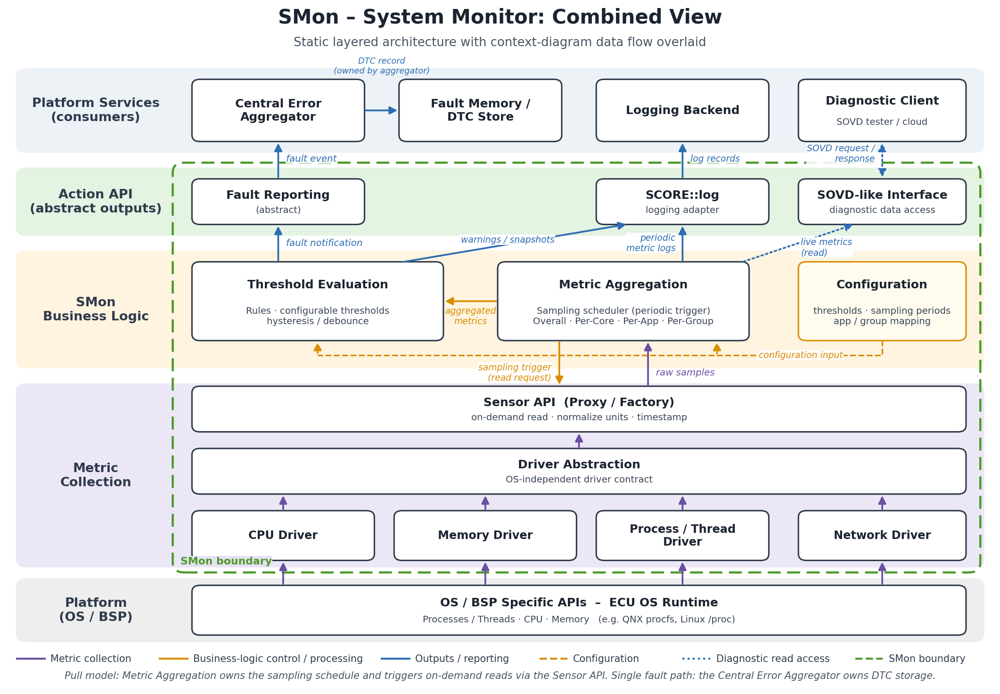

..
   # *******************************************************************************
   # Copyright (c) 2026 Contributors to the Eclipse Foundation
   #
   # See the NOTICE file(s) distributed with this work for additional
   # information regarding copyright ownership.
   #
   # This program and the accompanying materials are made available under the
   # terms of the Apache License Version 2.0 which is available at
   # https://www.apache.org/licenses/LICENSE-2.0
   #
   # SPDX-License-Identifier: Apache-2.0
   # *******************************************************************************

.. _system_monitoring_feature:

System Monitoring
#################

.. document:: System Monitoring
   :id: doc__smon
   :status: valid
   :version: 1
   :safety: ASIL_B
   :security: NO
   :realizes: wp__feat_request[version==1]
   :tags: feature_request, system_monitoring

.. feat:: System Monitoring
   :id: feat__smon
   :security: NO
   :safety: ASIL_B
   :status: valid
   :version: 1

.. toctree::
   :maxdepth: 1
   :glob:

   requirements/index

.. contents:: Table of Contents
   :depth: 2
   :local:

----

**********************************
1. Motivation & Problem Statement
**********************************

Modern automotive Domain Controller ECUs run dozens of concurrent applications — navigation stacks,
ADAS pipelines, infotainment services, and communication middleware — all sharing a single hardware
platform. Without a dedicated, standardized system monitoring layer at the middleware level, the
following problems arise:

* **Silent resource exhaustion:** A misbehaving application can consume excessive CPU or memory
  without any system-level detection, leading to degraded performance or safety-critical failures
  with no traceable fault record.

* **No standardized fault reporting path:** Individual application teams implement ad-hoc watchdog
  logic, making it impossible to consolidate health data into a unified error aggregator or fault
  memory (DTC store) in a consistent and maintainable way.

* **Platform fragmentation:** Monitoring utilities written for one OS (e.g., Linux) are not
  portable to another (e.g., QNX), creating duplicated effort and inconsistent monitoring behavior
  across ECU variants within the same vehicle program.

* **Lack of application-group awareness:** OEM system integrators need to monitor the health of
  **logical groups** of applications (e.g., "ADAS stack", "Infotainment cluster") as a unit, not
  just individual processes in isolation.

* **No configurable threshold-based alerting:** There is no standard mechanism to define
  upper-bound thresholds per metric and automatically trigger graduated responses
  (warn → report error → record DTC) when those thresholds are breached.

* **OS-specific code mixed into monitoring logic:** Components that need the same OS data
  re-implement the OS calls ad hoc per metric, leading to duplicated, inconsistent code that
  cannot be unit tested without the target OS.

* **No contract between reading and exposing a metric:** Without a stable boundary between
  "how a metric is read" and "how it is exposed", every additional OS or metric forces
  changes in all consumers.

.. note::
   S-CORE currently provides no standardized middleware component that addresses periodic,
   system-level health monitoring with configurable thresholds, fault reporting integration,
   and cross-platform portability for automotive ECUs.

----

*******************
2. Goals & Scope
*******************

2.1 Goals
=========

The System Monitor (SMon) feature shall:

#. Provide a **standardized, reusable middleware component** for periodic CPU and memory health
   monitoring on automotive ECUs.
#. Enable **configurable threshold-based alerting** that integrates with the platform's error
   aggregator and fault memory.
#. Support **logical grouping of applications** for aggregate health monitoring, as required by
   OEM integration scenarios.
#. Be **portable across Linux and QNX** operating systems without requiring changes to the
   monitoring logic.
#. Expose **well-defined integration interfaces** for error reporting, DTC recording, and logging,
   so that platform adopters can bind their own backend implementations.
#. Be **fully configurable at runtime** via an external configuration file, without requiring
   recompilation.
#. Separate **OS-specific data acquisition (drivers)** from **OS-independent read API (sensors)**,
   so new metrics and target platforms can be added without changing consumers.
#. Make all monitoring logic **unit-testable on a development host** with mocked drivers.

2.2 Out of Scope
================

The following items are explicitly **out of scope** for this feature request:

* Network I/O, Disk I/O, or GPU monitoring (identified as future extensions)
* A graphical dashboard or visualization frontend
* AUTOSAR Classic support
* Functional Safety (FuSa) certification artifacts (may be addressed in a follow-up)

----

***********************
3. Integration Context
***********************

The SMon component sits between the **OS runtime** (from which it reads raw metrics) and three
**platform-provided services** to which it reports:

.. list-table::
   :widths: 35 65
   :header-rows: 1

   * - External Service
     - Role
   * - **Central Error Aggregator**
     - Receives fault notifications when configured thresholds are breached.
   * - **Fault Memory (DTC Store)**
     - Receives DTC records for persistent fault logging.
   * - **Logging Backend**
     - Receives structured metric snapshots and threshold warning messages.

.. important::
   These three integration points are **required interfaces** that must be fulfilled by the
   platform adopter. SMon does not mandate a specific implementation of any of them.

   *Figure 1 — High-level functional context of the SMon component within the ECU software stack.*

----

*********************************
4. Anticipated Future Extensions
*********************************

The following needs are **not in scope** for this initial feature request but are identified as
natural extensions of the proposed monitoring framework:

.. list-table::
   :widths: 30 70
   :header-rows: 1

   * - Future Need
     - Description
   * - **Additional metric sources**
     - Network I/O (e.g., SOME/IP, DDS traffic), Disk I/O, GPU utilization — extending the
       same monitoring framework via the existing source abstraction.
   * - **Threshold hysteresis**
     - Preventing alert "flapping" by requiring sustained threshold breaches over N consecutive
       cycles before triggering, and a separate lower watermark for clearing.
   * - **Live telemetry streaming**
     - Streaming real-time metrics over a network transport to external visualization tools or
       IDE dashboards.
