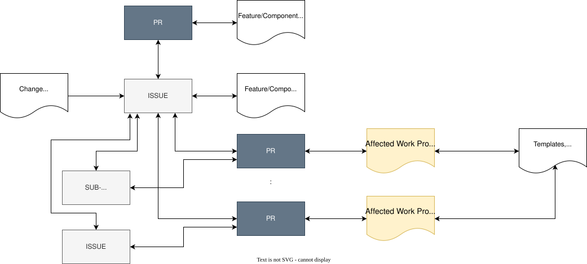
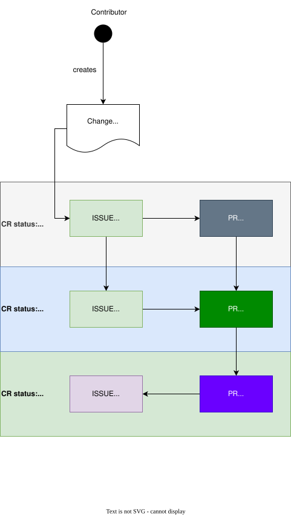

..
   # *******************************************************************************
   # Copyright (c) 2025 Contributors to the Eclipse Foundation
   #
   # See the NOTICE file(s) distributed with this work for additional
   # information regarding copyright ownership.
   #
   # This program and the accompanying materials are made available under the
   # terms of the Apache License Version 2.0 which is available at
   # https://www.apache.org/licenses/LICENSE-2.0
   #
   # SPDX-License-Identifier: Apache-2.0
   # *******************************************************************************

.. document:: PF Change Management Plan
   :id: doc__platform_change_management_plan
   :status: valid
   :version: 4
   :safety: ASIL_B
   :security: YES
   :tags: platform_management
   :realizes: wp__chm_plan[version==1]

.. _change_mgmt_plan:

PF Change Management Plan
=========================

This document implements the applicable parts of :need:`wp__platform_mgmt`.

Purpose
-------

The Change Management Plan defines how Change Requests are created, analyzed,
approved, implemented, monitored, and closed within S-CORE.

A Change Request represents the introduction of a new feature or component, or
a modification to the scope of an existing feature or component.

Objectives and Scope
--------------------

Change Management Goals
~~~~~~~~~~~~~~~~~~~~~~~

The objectives of change management are to ensure that:

* Change Requests are recorded and uniquely identified.
* Change Requests are analyzed before implementation, including identification
  of affected work products and assessment of the expected impact.
* Change Requests are approved before implementation begins.
* Approved Change Requests are implemented and their progress is monitored.
* Change Requests are tracked through closure and their status is communicated
  to affected parties.
* Change Requests and affected work products are bidirectionally traceable.

Change Management Scope
~~~~~~~~~~~~~~~~~~~~~~~

Change management applies to the work products and configuration items identified
in the :need:`PF Configuration Management Plan <doc__platform_config_mgt_plan>`.

It applies throughout the complete lifecycle of these work products and
configuration items, as defined in the Lifecycle section of
:need:`doc__platform_config_mgt_plan`.

This lifecycle scope is independent of the Expected Implementation Version or
Milestone assigned to an individual Change Request according to
:need:`gd_req__change_attr_milestone`. The Expected Implementation Version
defines the target release for implementing the Change Request; it does not
limit the applicability of change management.

Approach
--------

Change Request Execution
~~~~~~~~~~~~~~~~~~~~~~~~

General contribution rules for S-CORE are defined in
:need:`doc__contr_guideline`.

A Change Request is the controlled mechanism for introducing new features or
components, or for modifying the scope of existing features or components in
S-CORE.

Each Change Request is recorded as a GitHub Issue and implemented through one
or more associated GitHub Pull Requests.

Change Request Infrastructure and Types
~~~~~~~~~~~~~~~~~~~~~~~~~~~~~~~~~~~~~~~

.. note::

   Relevant parts of these templates are included in the GitHub ISSUE templates
   **Feature Request** and **Component Request**.

   Use **Feature Request** for a new feature or a modification of an existing
   feature. Use **Component Request** for a new component or a modification of
   an existing component.

   .. figure:: _assets/score_change_request_issue_templates.drawio.svg
      :width: 100%
      :align: center
      :alt: Feature Request and Component Request ISSUE templates

      Feature Request and Component Request ISSUE templates

A Change Request ISSUE may reference other ISSUEs or SUB-ISSUEs to decompose and
manage more complex changes.

Implementation of an accepted Change Request requires at least one PR linked to
the corresponding Change Request ISSUE.

   Change Request Overview

Change Requests are classified into the following types:

.. _Change Request Types:

.. list-table:: Change Request Types
   :header-rows: 1
   :widths: 20,55,25

   * - Type
     - Description
     - Infrastructure
   * - Feature
     - Introduction of a new feature and its associated work products.
     - ISSUE of type ``Feature Request`` with label ``feature_request``.
   * - Feature Modification
     - Modification of the scope of an existing feature or its associated work products.
     - ISSUE of type ``Feature Request`` with label ``feature_modification``.
   * - Component
     - Introduction of a new component and its associated work products.
     - ISSUE of type ``Component Request`` with label ``component_request``.
   * - Component Modification
     - Modification of the scope of an existing component or its associated work products.
     - ISSUE of type ``Component Request`` with label ``component_modification``.

The ISSUE type is determined by the selected ISSUE template. The label
distinguishes a new feature or component from a modification of an existing
one. It is assigned by the :need:`Contributor <rl__contributor>` or corrected
during review by a :need:`Committer <rl__committer>`.

Change Request traceability and impact analysis are supported by the following
tool requirements:

:need:`[[title]] <gd_req__change_tool_impact_analysis>`

.. _fep_track:

The FEP Track
~~~~~~~~~~~~~

* **Feature:** always follows the FEP Track.
* **Feature Modification:** follows the FEP Track if the change has major impact,
  for example if it affects the platform or other Feature Teams. Changes limited
  to the responsible Feature Team's domain may follow the standard workflow.
* **Component:** follows the standard Change Request workflow.
* **Component Modification:** follows the standard Change Request workflow.

Whether a Feature Modification constitutes a major change cannot be determined
solely by a fixed set of criteria. The responsible
:need:`Committer <rl__committer>` evaluates the impact in the context of the
change when it is proposed.

A change initially considered major may be excluded from the FEP Track by
community agreement if the additional governance process is not considered
necessary. Conversely, a proposed modification may be moved to the FEP Track
when its impact is subsequently determined to be major.

The baseline definition of a change is provided by the `Key Concept`_ in
``process_description``.

.. _Key Concept: https://eclipse-score.github.io/process_description/main/process_areas/change_management/change_management_concept.html#key-concept

Component and Component Modification Change Requests do not require a Shepherd
or Final Comment Period. The responsible team may nevertheless create a
Decision Record if a persistent record of the rationale is considered valuable.
Creating such a Decision Record does not by itself place the Change Request on
the FEP Track.

The FEP mechanism is not inherently restricted to a particular Change Request
type. Its current application to Features and major Feature Modifications defines
the present S-CORE process. Applying it to additional `Change Request types`_`
requires an explicit process decision.

FEP tracking ISSUE statuses refine the generic Change Request status model:

.. list-table:: FEP Status Mapping
   :header-rows: 1
   :widths: 30,20,50

   * - FEP tracking ISSUE status
     - Generic Change status
     - Meaning
   * - ``Draft - Needs Shepherd``
     - open
     - Proposal exists, but no Shepherd has been confirmed.
   * - ``Draft - Shepherded``
     - open
     - A Shepherd has been confirmed and the proposal is being prepared.
   * - ``Under Review``
     - in review
     - The proposal is in the Final Comment Period.
   * - ``Accepted``
     - in implementation
     - The FEP has been accepted and recorded as a Decision Record.
   * - ``Rejected`` / ``Withdrawn``
     - rejected
     - The proposal was rejected or withdrawn.
   * - ``Implementing``
     - in implementation
     - Implementation is ongoing and may be represented by linked or child ISSUEs.
   * - ``Implemented``
     - closed
     - The planned implementation has been completed.

Change Request Attributes
~~~~~~~~~~~~~~~~~~~~~~~~~
The attributes required by :need:`gd_req__change_attr_uid` are represented in
the Change Request infrastructure as follows.

:need:`[[title]] <gd_req__change_attr_uid>`
   The Change Request identifier is the GitHub ISSUE number.

:need:`[[title]] <gd_req__change_attr_status>`
   The Change Request status is derived from the ISSUE state, the Projects
   dashboard status, and the status of the associated PRs.

.. list-table:: Change Status
   :header-rows: 1
   :widths: 20,25,30,25

   * - Change Status
     - ISSUE State
     - Projects Status
     - Linked PR Status
   * - open
     - ``Open``
     - ``No Status``
     - ``Draft`` or ``Open``
   * - in review
     - ``Open``
     - ``Todo``
     - ``Draft`` or ``Open``
   * - in implementation
     - ``Open``
     - ``In Progress``
     - ``Draft`` or ``Open``
   * - closed
     - ``Closed``
     - ``Done``
     - ``Merged``
   * - rejected
     - ``Closed as not planned``
     - n/a
     - n/a

:need:`[[title]] <gd_req__change_attr_title>`
   The Change Request title is the GitHub ISSUE title.

:need:`[[title]] <gd_req__change_attr_impact_description>`
   The initial impact description is recorded in the Feature/Component Request
   description and impact-analysis sections of the ISSUE. Detailed analysis may
   subsequently be documented in associated PRs using the applicable request
   and Impact Analysis templates.

The request date is the ISSUE creation date and is recorded automatically by
GitHub.

The starting configuration is the state of the ``main`` branch, or the
applicable baseline, when the Change Request is created. Where applicable, this
state can be identified by the base commit of the associated PR. It is distinct
from the Expected Implementation Version, which defines the target release for
the requested change.

Additional implementation information may be maintained in associated PRs.

:need:`[[title]] <gd_req__change_attr_impact_safety>` and

:need:`[[title]] <gd_req__change_attr_impact_security>`
   Safety and security relevance are recorded in the corresponding sections of
   the ISSUE.

The applicable classification shall be selected as ``none``,
``Safety relevant``, ``Security relevant``, or a combination of safety and
security relevance. If ``none`` is selected, the change is considered
Quality-relevant only.

The expected ASIL classification is recorded in the corresponding ISSUE field,
for example ``QM`` or ``ASIL_B``.

:need:`[[title]] <gd_req__change_attr_types>`
   The Change Request type is represented by the ISSUE template
   (``Feature Request`` or ``Component Request``) together with the corresponding
   Change Request label.

:need:`[[title]] <gd_req__change_attr_affected_wp>`
   Initially affected work products are recorded in the Expected Changes of Work
   Products section of the ISSUE. Additional affected work products identified
   during analysis or implementation are recorded in the associated PRs or
   linked ISSUEs.

:need:`[[title]] <gd_req__change_attr_milestone>`
   The planned target release is recorded as the Expected Implementation Version.
   A GitHub Milestone may additionally be assigned.

For an accepted Change Request, implementation responsibility is recorded
through the assignees of the Change Request ISSUE and/or its linked
implementation ISSUEs and PRs.

.. _change_mgmt_workflow:

Change Request Workflow
~~~~~~~~~~~~~~~~~~~~~~~

Every Change Request follows four principal steps:

#. **Create** the Change Request.
#. **Analyze** and decide on the Change Request.
#. **Implement** the accepted Change Request and track its realization.
#. **Close** the Change Request after successful completion.

The colors used for these steps correspond to the Change Request Simple Workflow
Overview shown below.

:need:`gd_guidl__change_change_request` provides additional guidance.

1. Create the Change Request
^^^^^^^^^^^^^^^^^^^^^^^^^^^^

A Change Request shall be created as a GitHub ISSUE using the **Feature Request**
or **Component Request** ISSUE template.

The selected template establishes the appropriate ISSUE type. The corresponding
Change Request label defined under `Change Request Types`_ shall then be assigned.

The ISSUE title shall summarize the proposed change, and the template shall be
completed with the available information about the request, expected impact,
affected work products, and intended target release.

Detailed Feature or Component Request information and, where applicable, the
Impact Analysis are maintained as part of the Change Request and its associated
PRs.

For a new feature or component, the applicable
:need:`Feature Request <gd_temp__change_feature_request>` or
:need:`Component Request <gd_temp__change_component_request>` template shall be
used.

For a modification, the affected existing work products shall be updated.

Where applicable, :need:`Impact Analysis Template <gd_temp__change_impact_analysis>`
shall be completed.

At least one implementation PR shall be linked to an accepted Change Request
before its implementation can be completed.

Planning is recorded through the **Expected Implementation Version**. A GitHub
Milestone may additionally be assigned.

The initial Change Request status is ``open``:

* ISSUE state: ``Open``
* Projects status: ``No Status``
* Associated PR: ``Draft`` or ``Open``, if already available

To initiate review, the Change Request transitions to ``in review`` by keeping
the ISSUE ``Open`` and setting its Projects status to ``Todo``.

A Change Request that is rejected is closed using ``Closed as not planned``.

   Change Request Simple Workflow Overview

2. Analyze the Change Request
^^^^^^^^^^^^^^^^^^^^^^^^^^^^^

The Change Request is analyzed to determine its completeness, impact,
feasibility, affected work products, required implementation and verification
activities, and relevant safety or security implications.

For Change Requests following the standard workflow, a
:need:`Committer <rl__committer>` reviews the Change Request. Identified issues
are resolved by the :need:`Contributor <rl__contributor>`, and the analysis
results are documented in the ISSUE and/or associated PRs.

While additional information or review is required, the Change Request remains
``in review`` with ISSUE state ``Open`` and Projects status ``Todo``.

For Change Requests routed through the :ref:`FEP Track <fep_track>`, the
analysis and decision process defined by
:ref:`Feature & Enhancement Proposal (FEP) <feature_request_guideline>` replaces
the standard analysis process.

The decision to accept or reject the Change Request shall be documented.
Where safety or security relevance is applicable, the corresponding experts
shall review the classification and impact.

:need:`gd_chklst__change_cr_review` provides the applicable review criteria.

An accepted Change Request transitions to ``in implementation`` by keeping the
ISSUE ``Open`` and setting its Projects status to ``In Progress``.

A rejected Change Request is closed as ``Closed as not planned``.

3. Implement and Track the Change Request
^^^^^^^^^^^^^^^^^^^^^^^^^^^^^^^^^^^^^^^^^

For an accepted Change Request, the
:need:`Contributor <rl__contributor>` initiates the activities required to
implement and verify the change.

Implementation may be decomposed into additional ISSUEs and PRs. All such
implementation items shall be linked to the Change Request ISSUE to maintain
traceability and enable progress monitoring.

Implementation continues until the required activities have been completed and
the associated ISSUEs and PRs have been closed or merged as applicable.

Once implementation and verification are complete, the Projects status is set
to ``Done`` to initiate the final closure review by the
:need:`Committer <rl__committer>`.

If the Change Request is rejected or abandoned during implementation, the
decision shall be documented and the ISSUE closed using the applicable rejected
state.

4. Close the Change Request
^^^^^^^^^^^^^^^^^^^^^^^^^^^

The :need:`Committer <rl__committer>` performs the final review to confirm that
the accepted Change Request has been completely implemented and verified.

The review confirms, as applicable, that:

* required implementation activities have been completed;
* associated ISSUEs are closed;
* required PRs are merged;
* affected work products have been updated;
* required verification activities have been completed successfully;
* the verification results provide sufficient evidence that the change has
  achieved its intended purpose; and
* required traceability is complete.

:need:`gd_chklst__change_cr_review` provides additional closure criteria.
The affected realization work products are reviewed according to their
applicable review checklists.

If all closure criteria are fulfilled, the ISSUE is set to ``Closed``.

If further implementation or verification is required, the ISSUE remains open
and the Projects status is returned to ``In Progress``.

Change Management SW Platform Work Products
~~~~~~~~~~~~~~~~~~~~~~~~~~~~~~~~~~~~~~~~~~~

Not applicable.
