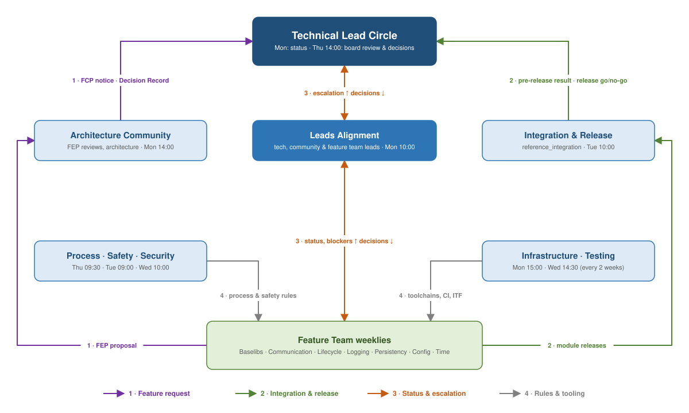

..
   # *******************************************************************************
   # Copyright (c) 2026 Contributors to the Eclipse Foundation
   #
   # See the NOTICE file(s) distributed with this work for additional
   # information regarding copyright ownership.
   #
   # This program and the accompanying materials are made available under the
   # terms of the Apache License Version 2.0 which is available at
   # https://www.apache.org/licenses/LICENSE-2.0
   #
   # SPDX-License-Identifier: Apache-2.0
   # *******************************************************************************

.. _project_at_a_glance:

Project at a Glance
===================

The short track through S-CORE: how the project is organized, which meetings matter, the key processes
and where to find the details.

.. image:: _assets/project_organization.drawio.svg
   :alt: S-CORE project organization: Technical Lead Circle, Communities and Feature Teams
   :align: center
   :width: 75%

Who does what
-------------

.. list-table::
   :header-rows: 1
   :widths: 20 80

   * - Body
     - Responsibility
   * - **Project / Technical Lead Circle (PLC/TLC)**
     - Strategic and technical decisions, triage of feature requests, adding/removing repositories,
       release planning and approval, escalation
   * - **Communities**
     - Topics that span all modules; each has a Community Lead
   * - **Feature Teams**
     - One module each, from architecture to integration test; each has a Lead and at least one Committer

Most important meetings
-----------------------

All meetings are open to everyone; times in CET/CEST, from the
`S-CORE calendar <https://calendar.google.com/calendar/u/0/embed?src=c_2ampi2bmoka3qter4dceap1d5g@group.calendar.google.com&ctz=Europe/Berlin>`__
(check there for changes). Minutes are posted in the
`GitHub Discussions <https://github.com/orgs/eclipse-score/discussions>`__ of each team and community.

.. list-table::
   :header-rows: 1
   :widths: 25 20 55

   * - Meeting
     - When
     - What happens
   * - **Technical Lead Circle**
       (`minutes <https://github.com/orgs/eclipse-score/discussions/516>`__)
     - twice a week: Mon (status), Thu 14:00 (board review)
     - **Mon:** status of milestones, bugs and open feature requests.
       **Thu:** review of product increments, epics and tasks; decisions on releases, versioning, scope and
       escalations.
   * - **Leads Alignment** (Tech Leads, Community Leads, Feature Team Leads)
       (`minutes <https://github.com/orgs/eclipse-score/discussions/434>`__)
     - weekly, Mon 10:00
     - All leads sync: cross-team dependencies, blockers, information from the TLC to the teams and
       escalations from the teams to the TLC.
   * - **Architecture Community**
       (`minutes <https://github.com/orgs/eclipse-score/discussions/2457>`__)
     - weekly, Mon 14:00
     - Architecture questions, contribution pitches and FEP reviews; cancelled when there are no agenda items.
   * - **SW Development Process Community**
       (`minutes <https://github.com/orgs/eclipse-score/discussions/407>`__)
     - weekly, Thu 09:30
     - Process development (news, updates, improvements), safety, security and quality management, process
       implementation in the tooling.
   * - **Safety Topics / Safety Management**
       (`minutes <https://github.com/orgs/eclipse-score/discussions/2234>`__)
     - weekly, Tue 09:00
     - Safety management and safety analyses across modules.
   * - **Security Topics / Security Management**
       (`minutes <https://github.com/orgs/eclipse-score/discussions/2226>`__)
     - weekly, Wed 10:00
     - Security management, threat analyses and security topics across modules.
   * - **Infrastructure Weekly**
       (`minutes <https://github.com/orgs/eclipse-score/discussions/236>`__)
     - weekly, Mon 15:00
     - Toolchains (C++, Rust, Python), CI/CD, devcontainer, docs-as-code, repository standards.
   * - **Testing Team**
       (`minutes <https://github.com/orgs/eclipse-score/discussions/2391>`__)
     - every 2 weeks, Wed 14:30
     - Test strategy, ITF and test tooling.
   * - **reference_integration** (Integration & Release,
       `minutes <https://github.com/orgs/eclipse-score/discussions/1595>`__)
     - weekly, Tue 10:00
     - Integration status, results of the weekly pre-release check, release preparation (release branches,
       release notes, known issues).
   * - **Feature Team weeklies**
     - weekly, per team
     - Progress, issue and PR triage, planning of the module. Minutes:
       `Baselibs <https://github.com/orgs/eclipse-score/discussions/2390>`__ (Wed 13:00),
       `Communication/IPC <https://github.com/orgs/eclipse-score/discussions/categories/communication-ft>`__ (Mon 15:00),
       `Lifecycle <https://github.com/orgs/eclipse-score/discussions/2386>`__ (Wed 10:00),
       `Logging <https://github.com/orgs/eclipse-score/discussions/categories/logging-ft>`__ (Tue 11:00),
       `Persistency <https://github.com/orgs/eclipse-score/discussions/2518>`__ (Thu 13:30),
       `Config Management <https://github.com/orgs/eclipse-score/discussions/2311>`__ (Tue 13:30),
       `Time <https://github.com/orgs/eclipse-score/discussions/2645>`__ (Fri 09:30).

How the meetings work together
^^^^^^^^^^^^^^^^^^^^^^^^^^^^^^

|

#. **Feature request:** a Feature Team (or any contributor) brings a FEP to the **Architecture Community**;
   it is reviewed there, goes through the Final Comment Period and ends as a Decision Record, which the
   **TLC** sees for its roadmap.
#. **Integration & release:** Feature Teams release their modules; the **reference_integration** meeting
   checks them every week in the pre-release check and prepares the platform release, which the **TLC**
   approves.
#. **Status & escalation:** Feature Teams report status and blockers to the **Leads Alignment**; what cannot
   be solved there goes to the **TLC**, and decisions flow back the same way.
#. **Rules & tooling:** the **Process, Safety and Security** meetings define the rules, **Infrastructure and
   Testing** provide toolchains, CI and test frameworks that all Feature Teams use.

Communities in one line
-----------------------

- **Architecture:** platform architecture, new features (FEP review), coding guidelines
- **Process:** development process incl. safety, security, quality (``process_description``)
- **Infrastructure:** toolchains, devcontainer, docs-as-code, CI/CD, Bazel registry
- **Testing:** test strategy, ITF, testing tools
- **Integration & Release:** ``reference_integration``, platform releases
- **Marketing & Communication:** website, events, public relations

Most important concepts
-----------------------

Common
^^^^^^

- **Decisions go up, work goes sideways:** the TLC decides; Communities set common rules; Feature Teams build
  the modules.
- **Teams are created or closed by the TLC.** A new team gets a GitHub team, repositories, CODEOWNERS, a
  project board, a label (``community:`` / ``ft:``) and a Slack channel.
- **Everything is open:** all meetings are in the S-CORE calendar and open to everyone; minutes are public in
  the GitHub Discussions.
- **Members and leads are defined by the CODEOWNERS** of the owned repositories.

Feature Request (FEP)
^^^^^^^^^^^^^^^^^^^^^

New features and changes with impact on the platform or other teams go through the
**Feature & Enhancement Proposal (FEP)** track (:ref:`FEP guideline <feature_request_guideline>`); changes inside one team use
the normal Issue/PR flow.

.. list-table::
   :header-rows: 1
   :widths: 25 75

   * - Phase
     - What happens
   * - 0 Idea
     - Post the idea in the architecture Slack channel, find a **Shepherd** (Architecture Community committer)
   * - 1 Draft
     - FEP as PR (Decision Record template) + tracking Issue *Feature Request*, label ``fep``;
       optional incubator repository ``inc_<topic>``
   * - 2 Final Comment Period
     - 14 days, a bot notifies all module maintainers; **silence = approval**, only substantive objections block
   * - 3 Decision
     - Accepted (PR merged as Decision Record), Rejected or Withdrawn; breaking changes need an explicit quorum
   * - 4 Implementation
     - The tracking Issue stays open until the implementation is merged

As defined in the :doc:`Project Management Plan </platform_management_plan/project_management>`, the TLC triages
incoming requests and is notified once a FEP enters its Final Comment Period.

Decision Record (DR)
^^^^^^^^^^^^^^^^^^^^

- Every relevant decision is a **Decision Record** (``dec_rec`` need) in :doc:`/design_decisions/index`,
  created by PR.
- Grouped by category: **strategy, architecture, infrastructure, process, integration, AI**
  (e.g. ``DR-003-Strat`` module maturity levels).
- Status: ``proposed`` → ``accepted``; a DR keeps the original decision and rationale, guidelines built on it
  may evolve separately.
- Accepted FEPs become DRs; a team may also write a DR for its own decisions to persist the rationale.

Integration & Release process
^^^^^^^^^^^^^^^^^^^^^^^^^^^^^

- **Releases** are `milestones <https://github.com/eclipse-score/score/milestones>`__ in the score repository,
  planned and approved by the TLC.
- **Modules** release independently (strict SemVer) into the
  `S-CORE Bazel registry <https://github.com/eclipse-score/bazel_registry>`__. SemVer applies to the
  **public API and features**: only a backward-incompatible change (breaking API change, removed or
  incompatibly changed feature) means a new MAJOR version; compatible enhancements are MINOR, fixes PATCH.
- **Reference Integration** pins every module in
  `known_good.json <https://github.com/eclipse-score/reference_integration/blob/main/known_good.json>`__
  (release or exact commit), builds them together and runs tests, showcases and images on all target
  platforms (see :ref:`integration_process`).
- **Weekly pre-release check:** every week all modules are bumped to their latest release on a pre-release
  branch to see early whether they still work together; modules already pinned to a newer, not yet released
  commit keep that commit, so the check may also include unreleased code.
- **Release:** release candidate branch → release note with module versions and **maturity** per module
  (Release / Experimental / Preview, DR-003).
- **Platform versions** (``1.0``, ``1.1``, …) follow a release train, not SemVer (proposal, to be confirmed).
  **For now, breaking API changes are allowed between all platform versions.** Small fixes may be carried as
  patches in ``reference_integration`` until the module releases them.

Module Maturity
^^^^^^^^^^^^^^^

Every module in a platform release carries exactly one maturity level
(:need:`dec_rec__strat__module_maturity_levels`). This lets all modules be part of the release while telling
users how far each one is.

.. list-table::
   :header-rows: 1
   :widths: 16 24 34 26

   * - Level
     - Process artifacts
     - Requirements
     - Quality statement
   * - **Preview**
     - none or incomplete
     - undetermined
     - not possible
   * - **Experimental**
     - complete
     - not all implemented / tested, gaps are transparent
     - yes, with known gaps
   * - **Release**
     - complete, only minor deviations
     - all implemented and fully tested
     - yes

- **Artifacts first:** without the process artifacts (verification report, traceability, inspection
  checklists) no quality statement is possible, so the module stays Preview.
- **Declared by the module:** each module sets ``:maturity: preview | experimental | release`` on its ``mod``
  need in its own docs (docs-as-code); the release note shows it per module.
- **Not yet defined:** exact border between minor and major deviations, who approves a level, and downgrades
  when the process changes.

Most important links
--------------------

All links to organization, meetings, contribution, decisions, integration & release, repositories and tooling
are collected in :ref:`useful_links`.
