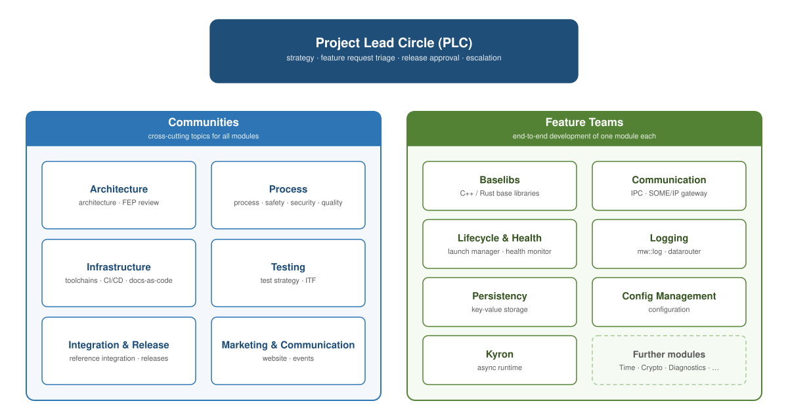
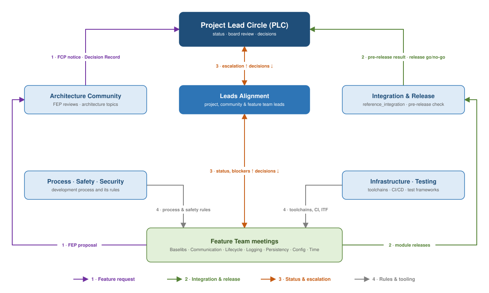

..
   # *******************************************************************************
   # Copyright (c) 2026 Contributors to the Eclipse Foundation
   #
   # See the NOTICE file(s) distributed with this work for additional
   # information regarding copyright ownership.
   #
   # This program and the accompanying materials are made available under the
   # terms of the Apache License Version 2.0 which is available at
   # https://www.apache.org/licenses/LICENSE-2.0
   #
   # SPDX-License-Identifier: Apache-2.0
   # *******************************************************************************

.. _project_at_a_glance:

Project at a Glance
===================

The short track through S-CORE: how the project is organized, which meetings matter, the key processes
and where to find the details.

Who does what
-------------

.. list-table::
   :header-rows: 1
   :widths: 20 80

   * - Body
     - Responsibility
   * - **Project Lead Circle (PLC)**
     - Strategic and technical decisions, triage of feature requests, adding/removing repositories,
       release planning and approval, escalation
   * - **Communities**
     - Topics that span all modules; each has a Community Lead and a deputy
   * - **Feature Teams**
     - One module each, from architecture to integration test; each has a Lead and at least one Committer

The bodies, their members and owned repositories are described in :ref:`Project Organization <pmp_pm_organization>`.

Most important meetings
-----------------------

All meetings are open to everyone; dates and times are in the
`S-CORE calendar <https://calendar.google.com/calendar/u/0/embed?src=c_2ampi2bmoka3qter4dceap1d5g@group.calendar.google.com&ctz=Europe/Berlin>`__.
The most important ones (Project Lead Circle, Leads Alignment, Community and Feature Team meetings), what happens
there and the links to their general information and minutes are listed in :ref:`Meetings <pmp_pm_meetings>`.

|

The diagram shows the main processes between the meetings, explained in
:ref:`How the meetings work together <pmp_pm_meetings_interaction>`.

Most important concepts
-----------------------

Common
^^^^^^

- **Decisions go up, work goes sideways:** the PLC decides; Communities set common rules; Feature Teams build
  the modules.
- **Teams are created or closed by the PLC** (see :doc:`/platform_management_plan/project_management`).
- **Everything is open:** all meetings are in the S-CORE calendar and open to everyone; minutes are public in
  the GitHub Discussions.
- **Members and leads are defined by the CODEOWNERS** of the owned repositories.

Feature Request (FEP)
^^^^^^^^^^^^^^^^^^^^^

New features and changes with impact on the platform or other teams go through the
**Feature & Enhancement Proposal (FEP)** track: the proposal is reviewed by the Architecture Community and
decided after a Final Comment Period; changes inside one team use the normal Issue/PR flow. The process is
described in the :ref:`FEP guideline <feature_request_guideline>`.

As defined in the :doc:`Project Management Plan </platform_management_plan/project_management>`, the PLC triages
incoming requests and is notified once a FEP enters its Final Comment Period.

Decision Record (DR)
^^^^^^^^^^^^^^^^^^^^

- Every relevant decision is a **Decision Record** (``dec_rec`` need) in :doc:`/design_decisions/index`,
  created by PR.
- Grouped by category: **strategy, architecture, infrastructure, process, integration, AI**
  (e.g. ``DR-003-Strat`` module maturity levels).
- Status: ``proposed`` → ``accepted``; a DR keeps the original decision and rationale, guidelines built on it
  may evolve separately.
- Accepted FEPs become DRs; a team may also write a DR for its own decisions to persist the rationale.

Integration & Release process
^^^^^^^^^^^^^^^^^^^^^^^^^^^^^

- **Releases** are `milestones <https://github.com/eclipse-score/score/milestones>`__ in the score repository,
  planned and approved by the PLC.
- **Modules** release independently (strict SemVer) into the
  `S-CORE Bazel registry <https://github.com/eclipse-score/bazel_registry>`__. SemVer applies to the
  **public API and features**: only a backward-incompatible change (breaking API change, removed or
  incompatibly changed feature) means a new MAJOR version; compatible enhancements are MINOR, fixes PATCH.
- **Reference Integration** pins every module in
  `known_good.json <https://github.com/eclipse-score/reference_integration/blob/main/known_good.json>`__
  (release or exact commit), builds them together and runs tests, showcases and images on all target
  platforms (see :ref:`integration_process`).
- **Weekly pre-release check:** problems between module releases are found early, see
  :ref:`Weekly Pre-Release Check <pmp_rm_pre_release_check>`.
- **Release:** release candidate branch → release note with module versions and **maturity** per module
  (Release / Experimental / Preview, :need:`DR-003 <dec_rec__strat__module_maturity_levels>`).

Module Maturity
^^^^^^^^^^^^^^^

Every module in a platform release carries exactly one maturity level
(:need:`dec_rec__strat__module_maturity_levels`). This lets all modules be part of the release while telling
users how far each one is.

.. list-table::
   :header-rows: 1
   :widths: 16 24 34 26

   * - Level
     - Process artifacts
     - Requirements
     - Quality statement
   * - **Preview**
     - none or incomplete
     - undetermined
     - not possible
   * - **Experimental**
     - complete
     - not all implemented / tested, gaps are transparent
     - yes, with known gaps
   * - **Release**
     - complete, only minor deviations
     - all implemented and fully tested
     - yes

- **Artifacts first:** without the process artifacts (verification report, traceability, inspection
  checklists) no quality statement is possible, so the module stays Preview.
- **Declared by the module:** each module sets ``:maturity: preview | experimental | release`` on its ``mod``
  need in its own docs (docs-as-code); the release note shows it per module.
- **Not yet defined:** exact border between minor and major deviations, who approves a level, and downgrades
  when the process changes.

Most important links
--------------------

All links to organization, meetings, contribution, decisions, integration & release, repositories and tooling
are collected in :ref:`useful_links`.
