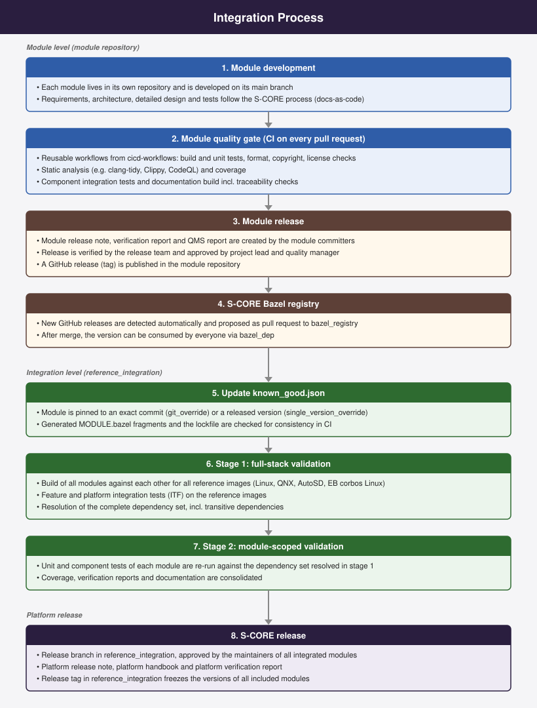

..
   # *******************************************************************************
   # Copyright (c) 2026 Contributors to the Eclipse Foundation
   #
   # See the NOTICE file(s) distributed with this work for additional
   # information regarding copyright ownership.
   #
   # This program and the accompanying materials are made available under the
   # terms of the Apache License Version 2.0 which is available at
   # https://www.apache.org/licenses/LICENSE-2.0
   #
   # SPDX-License-Identifier: Apache-2.0
   # *******************************************************************************
.. _integration_process:

Integration process
====================

The integration process is a core activity within Eclipse S-CORE and is still evolving as the project gathers experience.
Its current scope was agreed in the decision record :need:`dec_rec__int__scope_reference_integration`
(*stable known good with module-scoped validation*).
This chapter gives a high-level overview of how modules get from their own repository into an S-CORE release.
A detailed step-by-step guide for module owners is available in the
`integration process how-to <https://eclipse-score.github.io/reference_integration/main/integration_process/integration_process.html>`_
of the reference integration.

|

Module level
------------

Compliance with the Eclipse S-CORE software development process
^^^^^^^^^^^^^^^^^^^^^^^^^^^^^^^^^^^^^^^^^^^^^^^^^^^^^^^^^^^^^^^
All software modules - whether inside or outside the Eclipse S-CORE GitHub organization -
are encouraged to follow the Eclipse S-CORE development process strictly and to enforce it through CI/CD checks.
This ensures that compliance is validated with every pull request.

However, strict compliance cannot always be guaranteed. Reasons include:

- Many modules are reused in other projects beyond S-CORE.
- Some modules originate from companies with their own established software development process.
  An immediate migration to the Eclipse S-CORE development process is not feasible.

Therefore, it is acceptable (but not recommended) for software modules to follow their own
software development process inside their repository. In this case, the missing evidence has to be provided
before the module can become part of an S-CORE release.

Module quality gate
^^^^^^^^^^^^^^^^^^^
Quality checks are executed as close as possible to their origin, i.e. in the module repository
against the module's own dependencies. Every pull request runs the module quality gate, typically
based on the reusable `cicd-workflows <https://github.com/eclipse-score/cicd-workflows>`_. Examples include:

- the code compiles for the supported platforms (e.g. with GCC for Linux and QCC for QNX)
- unit tests and component integration tests pass
- static code analysis and coverage
- formatting, copyright and license checks
- requirements, architecture, detailed design and tests are properly linked according to the metamodel
  (checked during the documentation build)

Module owners may need to update code or artefacts to meet these criteria.

Module release and S-CORE Bazel registry
^^^^^^^^^^^^^^^^^^^^^^^^^^^^^^^^^^^^^^^^
Modules are released independently of each other. For a module release, the module committers create the module
release note. Based on it, the module verification report and the QMS report, the release is verified by the release
team and approved by the project lead and the quality manager, as defined in the release management process. The release is then published as a GitHub
release (tag) in the module repository.

To make a release available to the community, the module is registered in the
`S-CORE Bazel registry <https://github.com/eclipse-score/bazel_registry>`_. New GitHub releases of registered modules
are detected automatically and added to the registry via a pull request. After this pull request is merged,
every project can use the new version via ``bazel_dep``.

Reference Integration
---------------------

Passing the module quality gate ensures process compliance, but not compatibility with other modules.
This is the purpose of the `reference integration <https://github.com/eclipse-score/reference_integration>`_.

The reference integration assembles all modules into reference images
and executes feature integration tests. These tests ensure:

- correct implementation of feature requirements
- compatibility between dependent modules
- testability of features from an end-user perspective

Stable known good
^^^^^^^^^^^^^^^^^
The file `known_good.json <https://github.com/eclipse-score/reference_integration/blob/main/known_good.json>`_ is the single
source of truth for the modules which are part of the integration. Each module is pinned to an exact commit
(``git_override``) or to a released version from the registry (``single_version_override``), never to a floating branch.
The Bazel files of the reference integration are generated from this file, and CI checks that they are in sync.

A new module version, toolchain or third-party dependency is integrated by updating ``known_good.json``.
This creates a new candidate which only becomes the new *stable known good* after it passed the validation described below.

Unified Dependency Handling
^^^^^^^^^^^^^^^^^^^^^^^^^^^^
Within the reference integration, all module dependencies are overwritten by the versions defined in ``known_good.json``,
because the overrides of the root module apply to the whole Bazel dependency graph.

For example:
If the reference integration specifies software module "A" in version 1.0,
all software modules in that integration are built against "A" version 1.0 - regardless of their local dependency settings.
This ensures a consistent and unique state of all software module versions which are included
in the same reference integration.

Two-stage validation
^^^^^^^^^^^^^^^^^^^^
Every candidate is validated in two stages:

1. **Full-stack validation** in the reference integration: all modules are built against each other for all
   reference images (Linux, QNX, Red Hat AutoSD, Elektrobit corbos Linux), feature and platform integration tests
   are executed, and the complete dependency set, incl. transitive dependencies, is resolved.
2. **Module-scoped validation**: the unit and component tests of each module are executed again, but against
   the dependency versions resolved in stage 1. This way, the module tests stay in their natural repository context
   while the exact dependency set of the integrated platform is verified.

The results of both stages, e.g. test results, coverage and documentation, are consolidated into the reports of the reference integration.

Handling of Incompatibilities
^^^^^^^^^^^^^^^^^^^^^^^^^^^^^^
Introducing a new version into the reference integration can cause incompatibilities
if other modules have not yet adapted to changes.
Although proper planning and deprecation strategies help to avoid such issues, they cannot always be avoided.
Because the reference integration regularly integrates the latest state of the modules, such problems are detected early.
They have to be solved in the affected module repositories. Patches which are applied in the reference integration
on top of a module are only a temporary workaround and the exception, not the rule.

Release of Reference Integration
--------------------------------
Once:

- all feature integration tests have passed, and
- other Eclipse S-CORE project metrics for the release cycle are fulfilled

a new release of the reference integration is created. The release is prepared on a release branch, which has to be
approved by the maintainers of all integrated modules. An official S-CORE release typically consists of:

- A **release tag** in the reference integration repository (freezing the versions of all included software modules)
- **Platform Release Notes**, created and approved by the project lead circle
- the **Platform Handbook** and the **Platform Verification Report**
- **Additional documents as required**

This marks the complete and validated version of the Eclipse S-CORE platform for that release milestone.
All releases are listed on the `releases page <https://github.com/eclipse-score/reference_integration/releases>`_
of the reference integration; the release plan and roadmap are described in :ref:`releases`.
