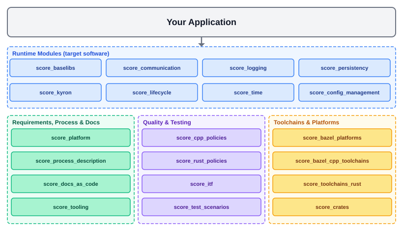
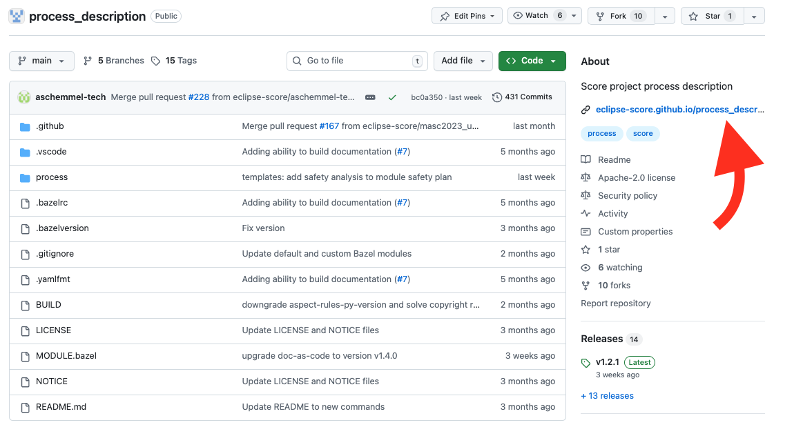

..
   # *******************************************************************************
   # Copyright (c) 2026 Contributors to the Eclipse Foundation
   #
   # See the NOTICE file(s) distributed with this work for additional
   # information regarding copyright ownership.
   #
   # This program and the accompanying materials are made available under the
   # terms of the Apache License Version 2.0 which is available at
   # https://www.apache.org/licenses/LICENSE-2.0
   #
   # SPDX-License-Identifier: Apache-2.0
   # *******************************************************************************

Module Structure Overview
==========================

As described in the :ref:`Technology Overview <technology_overview>` chapter, Eclipse S-CORE consists of multiple Bazel modules,
typically stored in separate repositories. Most modules reside in the `Eclipse S-CORE GitHub organization <https://github.com/eclipse-score>`_,
while some originate from other projects and are reused here. This chapter introduces
the most important Bazel modules and repositories in the Eclipse S-CORE GitHub organization.

The picture below shows them grouped by their purpose. An application typically depends on one or more
**runtime modules** (the target software). All other modules are used during development, e.g. to describe and verify
requirements, to build the documentation, to check code quality or to provide compilers.
The names in the boxes are the Bazel module names as used in ``bazel_dep(name = ...)``.

|

.. hint::
    Every repository generates its HTML documentation from rst files.
    The link to the published documentation is shown in the *About* section of the repository on GitHub,
    as shown in the picture below.

Eclipse S-CORE Platform
-----------------------
**Repository:** `eclipse-score/score <https://github.com/eclipse-score/score>`_ — **Bazel module:** ``score_platform``

This is the central repository of the project. It contains:

- stakeholder requirements
- Assumptions of Use (AoUs) for potential users
- the list of platform features, incl. feature requirements and feature architecture
- the high-level platform architecture
- the decomposition of the architecture into modules
- the definition of logical interfaces and module functionality
- the platform management plan and the design decisions

Module repositories reference the feature requirements and architecture of this repository
from their component requirements and architecture.

Process Description
--------------------
**Repository:** `eclipse-score/process_description <https://github.com/eclipse-score/process_description>`_ — **Bazel module:** ``score_process_description``

The process repository describes the Eclipse S-CORE software development process. It describes:

- the general concepts and principles of the Eclipse S-CORE software development process
- all `process areas <https://eclipse-score.github.io/process_description/main/process_areas/index.html>`_ in detail,
  from requirements engineering, architecture design and implementation over verification and safety and security analysis
  up to release, quality and tool management
- how work products such as requirements and architecture must be specified, incl. templates and checklists

How these processes are deployed within S-CORE is described in the :ref:`Platform Management Plan <pmp>`.

Docs-as-Code
------------
**Repository:** `eclipse-score/docs-as-code <https://github.com/eclipse-score/docs-as-code>`_ — **Bazel module:** ``score_docs_as_code``

The docs-as-code repository provides the tooling around the Sphinx and sphinx-needs framework, including:

- the ``docs`` Bazel macro which provides targets such as ``//:docs`` and ``//:live_preview`` in every repository
- traceability between requirements, architecture, source code and tests
- linking of process artefacts across repositories
- checks that validate the Eclipse S-CORE metamodel, as defined in the process description

The requirements for this tooling and their implementation status are available in the
`docs-as-code requirements <https://eclipse-score.github.io/docs-as-code/main/internals/requirements/index.html>`_.

Tooling
-------
**Repository:** `eclipse-score/tooling <https://github.com/eclipse-score/tooling>`_ — **Bazel module:** ``score_tooling``

The tooling repository collects supporting tools for the Eclipse S-CORE project, which are provided as Bazel rules and macros,
e.g. format and copyright checkers, the Eclipse Dash license check, Python linting and test utilities.

Development Environment
-----------------------
**Repository:** `eclipse-score/devcontainer <https://github.com/eclipse-score/devcontainer>`_ — **Bazel module:** ``score_devcontainer``

Provides the common `Dev Container <https://containers.dev/>`_ image for Eclipse S-CORE development.
It contains all required tools, compilers and VS Code extensions in well-defined versions.

The S-CORE repositories already reference this image in their ``.devcontainer`` folder. To get started, clone the repository
you want to work on, open it in VS Code with the
`Dev Containers extension <https://marketplace.visualstudio.com/items?itemName=ms-vscode-remote.remote-containers>`_
and select *Reopen in Container*. See also :ref:`setting up the development environment <setting_up_dev_env>`.

Module Template
---------------
**Repository:** `eclipse-score/module_template <https://github.com/eclipse-score/module_template>`_

A template repository for new C++ and Rust modules. It provides the standardized folder structure,
Bazel configuration, documentation setup, CI/CD workflows and development environment configuration.
Start from this template when creating a new module. The expected folder structure is described in
:ref:`module folder structure <module_folder_structure>`.

Code Quality Policies
---------------------
**Repositories:**

- `eclipse-score/score_cpp_policies <https://github.com/eclipse-score/score_cpp_policies>`_ — **Bazel module:** ``score_cpp_policies``
- `eclipse-score/score_rust_policies <https://github.com/eclipse-score/score_rust_policies>`_ — **Bazel module:** ``score_rust_policies``

These repositories provide centralized, version-controlled quality tool configurations, so that all modules use the same rules:

- **score_cpp_policies**: sanitizer configurations (ASan, UBSan, LSan, TSan) and a common clang-tidy baseline.
- **score_rust_policies**: Clippy configurations, a strict one for safety-critical code and a relaxed one for tooling and tests.

Toolchains and Bazel platforms
------------------------------
**Repositories:**

- `eclipse-score/bazel_cpp_toolchains <https://github.com/eclipse-score/bazel_cpp_toolchains>`_ — **Bazel module:** ``score_bazel_cpp_toolchains``
- `eclipse-score/toolchains_rust <https://github.com/eclipse-score/toolchains_rust>`_ — **Bazel module:** ``score_toolchains_rust``
- `eclipse-score/bazel_platforms <https://github.com/eclipse-score/bazel_platforms>`_ — **Bazel module:** ``score_bazel_platforms``

``score_bazel_cpp_toolchains`` provides the configuration for the GCC-based C/C++ toolchains of all supported targets:
Linux host builds, QNX SDP 8.0 cross-compilation, Red Hat AutoSD and Elektrobit corbos Linux for Safety Applications.
It replaces the former, now archived, ``toolchains_gcc`` and ``toolchains_qnx`` modules.

``score_toolchains_rust`` provides pre-built `Ferrocene <https://ferrocene.dev/>`_ toolchains for Rust,
covering Linux and QNX targets on x86_64 and aarch64, incl. coverage tooling.

``score_bazel_platforms`` defines the platforms supported by Eclipse S-CORE
(e.g., ``x86_64-qnx-sdp_8.0.0-posix``), see its
`BUILD <https://github.com/eclipse-score/bazel_platforms/blob/main/BUILD>`_ file.

Third-party Rust crates are provided as a defined set via
`eclipse-score/score-crates <https://github.com/eclipse-score/score-crates>`_ (Bazel module ``score_crates``).

CI/CD Automation
----------------
**Repositories:**

- `eclipse-score/cicd-workflows <https://github.com/eclipse-score/cicd-workflows>`_
- `eclipse-score/cicd-actions <https://github.com/eclipse-score/cicd-actions>`_

These repositories provide reusable GitHub Actions workflows and composite actions used across all
Eclipse S-CORE module repositories. Module teams reference these shared workflows instead of
duplicating CI/CD logic, ensuring consistent quality gates and pipeline behaviour.

Bazel Registry
---------------
**Repository:** `eclipse-score/bazel_registry <https://github.com/eclipse-score/bazel_registry>`_

The S-CORE Bazel registry is essential for publishing official releases of all Eclipse S-CORE Bazel modules.
It does not host source code, but only the metadata of each module version.
New GitHub releases of the registered modules are detected automatically and added to the registry via a pull request.
The content of the registry can be browsed in the `Bazel registry UI <https://eclipse-score.github.io/bazel_registry_ui/>`_.

Software Modules
----------------
**Repository** (example — baselibs): `eclipse-score/baselibs <https://github.com/eclipse-score/baselibs>`_

Each software module is a Bazel module stored in its own repository. Software modules typically include:

- component requirements and architecture
- detailed design
- implementation
- unit and component integration tests
- documentation, incl. the safety and security work products of the module

The runtime modules which are currently part of the reference integration are shown in the picture at the top of this page
(e.g. ``score_baselibs``, ``score_communication``, ``score_logging``, ``score_persistency``, ``score_kyron``,
``score_lifecycle``, ``score_time`` and ``score_config_management``). The current list is maintained in
`known_good.json <https://github.com/eclipse-score/reference_integration/blob/main/known_good.json>`_ of the reference integration.
New features are often started in *incubation* repositories (prefix ``inc_``) before they become a regular module.

Modules usually depend on other modules in the Eclipse S-CORE GitHub organization, especially on

- `eclipse-score/score <https://github.com/eclipse-score/score>`_ to reference feature requirements and architecture
  in the component requirements and architecture
- `eclipse-score/docs-as-code <https://github.com/eclipse-score/docs-as-code>`_ for the Sphinx/sphinx-needs framework and tooling around it
- **toolchains** modules for the compiler toolchains
- the **policy** modules for the code quality rules.

Reference Integration
----------------------
**Repository:** `eclipse-score/reference_integration <https://github.com/eclipse-score/reference_integration>`_

This repository is a key part of the Eclipse S-CORE project.
All Eclipse S-CORE modules are integrated together to ensure that they fit to each other.
The modules and their exact versions are defined in ``known_good.json``. The repository integrates all
software modules into reference images to verify that:

- all module dependencies are consistent
- modules work correctly together
- feature requirements are fulfilled

Reference images currently exist for Linux x86_64 (Docker), QNX 8.0 x86_64 and aarch64 (QEMU, Raspberry Pi),
Red Hat AutoSD and Elektrobit corbos Linux for Safety Applications (aarch64).
Feature integration tests are executed on these reference images to validate the complete platform.
The repository also contains *showcases*, small example applications which demonstrate how to use the S-CORE modules,
and builds the consolidated documentation of all integrated modules.
More details are given in the :ref:`integration process <integration_process>` chapter.

Integration Testing Framework
------------------------------
**Repository:** `eclipse-score/itf <https://github.com/eclipse-score/itf>`_ — **Bazel module:** ``score_itf``

The Integration Testing Framework (ITF) is a pytest-based framework to implement and execute
Feature Integration Tests (FIT). It runs tests on different targets, such as Docker containers,
QEMU virtual machines and real hardware, and is integrated into Bazel via the ``py_itf_test`` macro.
Module teams write FIT test cases using ITF to verify end-to-end feature behaviour across module boundaries.
Documentation is available in the `ITF documentation <https://eclipse-score.github.io/itf/>`_.

Testing Tools
-------------
**Repository:** `eclipse-score/testing_tools <https://github.com/eclipse-score/testing_tools>`_ — **Bazel module:** ``score_test_scenarios``

Provides shared utilities for test automation: Rust and C++ libraries to implement test scenarios and
Python helpers to execute them and to evaluate their results and logs.
They are used for Component Integration Tests (CIT), which verify the interaction between a module
and its direct dependencies without requiring a full reference image, as well as for the
feature integration tests in the reference integration.
