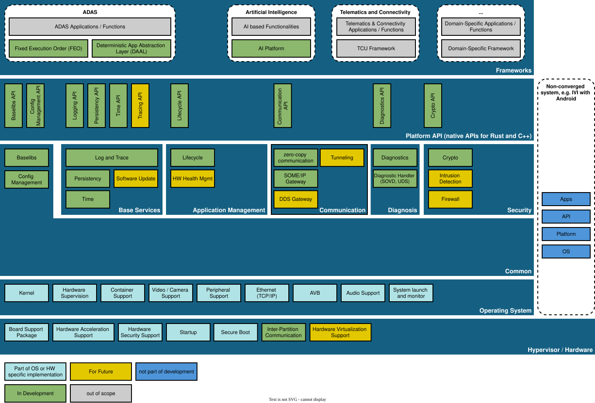

..
   # *******************************************************************************
   # Copyright (c) 2026 Contributors to the Eclipse Foundation
   #
   # See the NOTICE file(s) distributed with this work for additional
   # information regarding copyright ownership.
   #
   # This program and the accompanying materials are made available under the
   # terms of the Apache License Version 2.0 which is available at
   # https://www.apache.org/licenses/LICENSE-2.0
   #
   # SPDX-License-Identifier: Apache-2.0
   # *******************************************************************************

Software Architecture Overview
================================

The following picture shows the high-level architecture of the Eclipse S-CORE platform.
It is the same picture as on the :ref:`Platform Architecture <platform_architecture>` page, which is the
single source of truth. The architecture is continuously refined and will evolve in future releases.

From features to modules
------------------------

The architecture is described on two levels, which you will find again in all S-CORE repositories:

- A **Feature** is a logical entity of the platform (e.g. *Persistency* or *Communication*).
  Feature requirements and the feature architecture are maintained in this repository,
  see :ref:`Platform Features <features>`.
- A **Module** is an independently developed and delivered software building block consisting
  of one or more components. The components of a module contribute to the realization of one
  or more features. Modules are maintained in dedicated module repositories, which may host
  one or more related modules. Component requirements, component architecture, detailed design,
  implementation and tests are maintained with the respective module, see :ref:`Modules <modules>`
  and the :doc:`module structure overview <module_structure_overview>`.

The relation between both levels is explained in the
`building blocks concept <https://eclipse-score.github.io/process_description/main/general_concepts/score_building_blocks_concept.html>`_
of the process description.

Evolving the architecture
-------------------------

Eclipse S-CORE has a `software architecture community <https://github.com/orgs/eclipse-score/discussions/categories/architecture-community>`_
**responsible for maintaining and evolving the architecture**.

Structural changes and new functionality are proposed through a **Feature & Enhancement Proposal (FEP)**.
All **past feature requests** are documented in the corresponding
`Feature Requests / Modification <https://github.com/orgs/eclipse-score/projects/4/views/1>`_ GitHub project.

**Submitting a FEP** is described in the :ref:`Feature & Enhancement Proposal (FEP) <feature_request_guideline>` guideline.
Larger architectural decisions are documented as decision records in the :doc:`design decisions <../../design_decisions/index>` section.
Participation in the architecture process is encouraged.

The **software architecture community regularly organizes workshops** where contributors can:

- present new ideas
- discuss **approved new feature requests**, and
- evaluate whether **existing solutions** from other projects can be adopted.

These workshops are open for participation both online and onsite.
