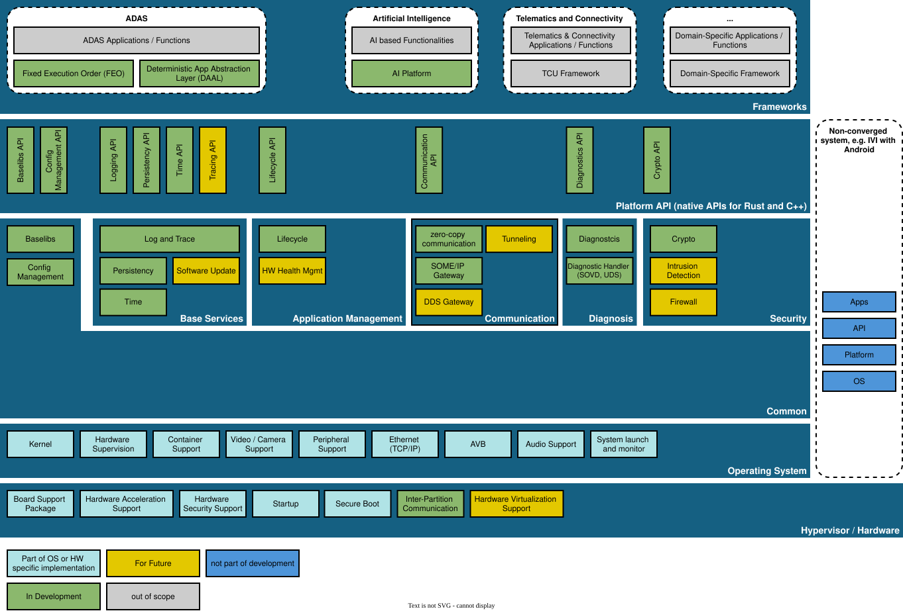

..
   # *******************************************************************************
   # Copyright (c) 2026 Contributors to the Eclipse Foundation
   #
   # See the NOTICE file(s) distributed with this work for additional
   # information regarding copyright ownership.
   #
   # This program and the accompanying materials are made available under the
   # terms of the Apache License Version 2.0 which is available at
   # https://www.apache.org/licenses/LICENSE-2.0
   #
   # SPDX-License-Identifier: Apache-2.0
   # *******************************************************************************

Software Architecture Overview
================================

The following picture shows the high-level architecture of the Eclipse S-CORE platform.
It is the same picture as on the :ref:`Platform Architecture <platform_architecture>` page, which is the
single source of truth. The architecture is continuously refined and will evolve in future releases.

|

Reading the picture
-------------------

The platform is organized in layers. From top to bottom:

- **Frameworks** — domain-specific frameworks on which applications are built, e.g. for ADAS the
  *Fixed Execution Order (FEO)* framework and the *Deterministic App Abstraction Layer (DAAL)*,
  or the *AI Platform*. Applications and domain frameworks for other domains (e.g. telematics) are shown
  for context only.
- **Platform API** — the native C++ and Rust APIs that applications use, e.g. for logging, persistency,
  time, lifecycle, communication, diagnostics and crypto.
- **Platform services** — the implementations behind these APIs, grouped into *Base Services*
  (logging, tracing, persistency, time, software update), *Application Management* (lifecycle, health management),
  *Communication* (zero-copy IPC, SOME/IP and DDS gateways), *Diagnosis* and *Security*.
- **Common** — functionality shared by all other parts, such as the base libraries (*baselibs*)
  and configuration management.
- **Operating System** and **Hypervisor / Hardware** — S-CORE builds on existing POSIX-compliant operating
  systems (e.g. QNX, Linux) instead of developing its own. The expectations towards the operating system are
  described in the :ref:`OS module <comp_doc_os>` and as assumptions of use in the
  :doc:`platform assumptions </requirements/platform_assumptions/index>`.

The colors indicate the status of each building block: *in development*, *for future*, *not part of development*,
*out of scope*, or *part of the operating system / hardware specific implementation*.
The box on the right side shows that S-CORE can run next to a non-converged system, e.g. an IVI system with Android.

From features to modules
------------------------

The architecture is described on two levels, which you will find again in all S-CORE repositories:

- A **Feature** is a logical entity of the platform (e.g. *Persistency* or *Communication*).
  Feature requirements and the feature architecture are maintained in this repository,
  see :ref:`Platform Features <features>`.
- A **Module** is the physically built and released unit that implements one or more features.
  Each module lives in its own repository and contains the component requirements, component architecture,
  detailed design, implementation and tests, see :ref:`Modules <modules>` and the
  :doc:`module structure overview <module_structure_overview>`.

The relation between both levels is explained in the
`building blocks concept <https://eclipse-score.github.io/process_description/main/general_concepts/score_building_blocks_concept.html>`_
of the process description.

Evolving the architecture
-------------------------

Eclipse S-CORE has a `software architecture community <https://github.com/orgs/eclipse-score/discussions/categories/architecture-community>`_
**responsible for maintaining and evolving the architecture**.

Structural changes and new functionality are proposed through a **Feature & Enhancement Proposal (FEP)**.
All **past feature requests** are documented in the corresponding
`Feature Requests / Modification <https://github.com/orgs/eclipse-score/projects/4/views/1>`_ GitHub project.

**Submitting a FEP** is described in the :ref:`Feature & Enhancement Proposal (FEP) <feature_request_guideline>` guideline.
Larger architectural decisions are documented as decision records in the :doc:`design decisions </design_decisions/index>` section.
Participation in the architecture process is encouraged.

The **software architecture community regularly organizes workshops** where contributors can:

- present new ideas
- discuss **approved new feature requests**, and
- evaluate whether **existing solutions** from other projects can be adopted.

These workshops are open for participation both online and onsite.
