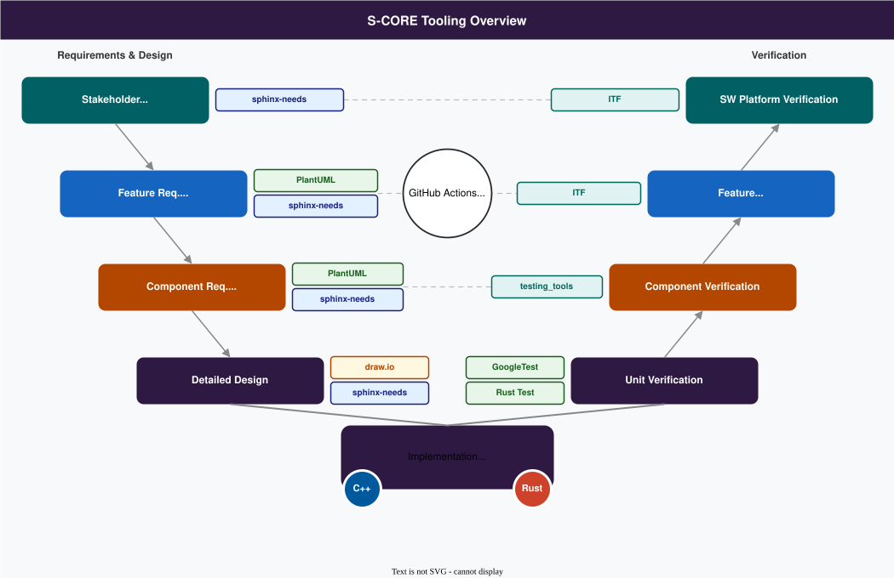

..
   # *******************************************************************************
   # Copyright (c) 2026 Contributors to the Eclipse Foundation
   #
   # See the NOTICE file(s) distributed with this work for additional
   # information regarding copyright ownership.
   #
   # This program and the accompanying materials are made available under the
   # terms of the Apache License Version 2.0 which is available at
   # https://www.apache.org/licenses/LICENSE-2.0
   #
   # SPDX-License-Identifier: Apache-2.0
   # *******************************************************************************

.. _technology_overview:

Overview of technologies
===========================

S-CORE Tooling
----------------
Eclipse S-CORE uses a fully open-source toolchain. This ensures a smooth onboarding
experience and enables efficient collaboration across contributors with different backgrounds.
The following sections give an overview of the key technologies, followed by detailed explanations
of each tool and process step.

.. note::

   This chapter provides a general overview of the S-CORE toolchain. For a deeper technical
   dive, refer to the `Infrastructure Community page <https://eclipse-score.github.io/infrastructure/>`_.
   The complete list of tools, their versions and qualification status is maintained in the
   :ref:`S-CORE tools <tools>` section.

|

The picture follows the V-model of the S-CORE development process:

- On the **left side**, stakeholder requirements, feature requirements and architecture, component requirements
  and architecture, and the detailed design are written as *docs-as-code* using **sphinx-needs**.
  Diagrams are created with **PlantUML** or **draw.io**.
- At the **bottom**, the implementation in **C++** and **Rust** is built with **Bazel**.
- On the **right side**, each level is verified by a matching test level: unit tests (**GoogleTest**, **Rust test**),
  component integration tests (Python test scenarios from **testing_tools**), and feature and platform
  integration tests with the **Integration Testing Framework (ITF)**.
- **GitHub Actions** executes all steps automatically on every pull request.

Bazel and repository structure
------------------------------
The whole Eclipse S-CORE project is built on the `Bazel <https://bazel.build/>`_ build system.
Almost all automated steps – such as requirement validation, documentation generation,
source code compilation, unit test execution and integration tests – are executed through Bazel targets.
The CI/CD pipeline is the only major exception.

Bazel provides **hermetic** and **reproducible** builds,
which are important for software developed for Functional Safety.
Bazel can be extended using
`Bazel macros <https://bazel.build/extending/macros>`_ and
`Bazel rules <https://bazel.build/extending/rules>`_, allowing project-specific build logic.
S-CORE provides such rules and macros, e.g. in the ``score_tooling`` and ``score_docs_as_code`` modules.

S-CORE makes strong use of `Bazel modules (bzlmod) <https://bazel.build/external/module>`_.
The project consists of multiple repositories, each implementing a specific piece of functionality.
Every repository is a Bazel module with a ``MODULE.bazel`` file at its root, and module names follow the
``score_<name>`` convention (e.g. ``score_baselibs``, or ``score_platform`` for this repository).
The modular approach improves reuse, because independent modules can be integrated into different
projects more easily than a single monolithic repository.

Released module versions are published in the
`S-CORE Bazel registry <https://github.com/eclipse-score/bazel_registry>`_,
a `Bazel registry <https://bazel.build/external/registry>`_ which is used in addition to the
Bazel Central Registry (BCR). To consume S-CORE modules, add both registries to your ``.bazelrc``:

.. code-block:: text

   common --registry=https://raw.githubusercontent.com/eclipse-score/bazel_registry/main/
   common --registry=https://bcr.bazel.build

and declare the modules you need in your ``MODULE.bazel``, e.g.:

.. code-block:: python

   bazel_dep(name = "score_baselibs", version = "<version>")

The available modules and versions can be browsed in the
`Bazel registry UI <https://eclipse-score.github.io/bazel_registry_ui/>`_.

However, modularity also introduces organizational and technical challenges:

- Each module is maintained by a dedicated team, which increases coordination needs.
  Please have a look at the :ref:`project management plan <pmp_pm_plan>`
  for more details regarding S-CORE's organizational structure.
- Bazel resolves dependencies between modules, but it does not guarantee that the selected versions
  work together. Eclipse S-CORE's approach for technical integration is described in the
  :ref:`integration process <integration_process>`.

In summary, **Eclipse S-CORE acts as an integration project,
combining modules** from other projects with **new modules** specifically developed for Eclipse S-CORE.
The main responsibility is to ensure that all modules work seamlessly together and form
a platform that can serve as the basis for future Functional-Safety-qualifiable products.

Development environment
-----------------------
S-CORE repositories provide a ``.devcontainer`` configuration which is based on the common
`S-CORE devcontainer <https://github.com/eclipse-score/devcontainer>`_. It contains all tools in well-defined
versions (Bazel, compilers, Python, linters, ...). Open a repository in a
`devcontainer capable editor <https://containers.dev/supporting>`_, e.g. VS Code, and select
*Reopen in Container* — no further manual setup is needed.
Details are described in :ref:`setting up the development environment <setting_up_dev_env>`.

CI/CD pipeline
---------------
The CI/CD pipeline follows modern industry practices.
It is based on GitHub infrastructure and uses `GitHub Actions <https://docs.github.com/en/actions>`_
for automation and for executing all CI/CD checks.

To keep the pipelines consistent across all repositories, the module repositories use the reusable workflows from
`cicd-workflows <https://github.com/eclipse-score/cicd-workflows>`_ and actions from
`cicd-actions <https://github.com/eclipse-score/cicd-actions>`_. Typical checks on every pull request are:

- build and tests (GoogleTest, Rust test, pytest) on the supported platforms, incl. gated QNX builds
- formatting, copyright header and Bazel lockfile checks
- static code analysis (e.g. clang-tidy, Clippy, CodeQL) and code coverage
- license compliance check with the Eclipse Dash license tool
- documentation build, incl. traceability checks; the documentation is published to GitHub Pages

The same checks can be executed locally with Bazel before pushing a change, e.g.:

.. code-block:: bash

   bazel test //:format.check     # check formatting
   bazel run //:copyright.check   # check copyright headers
   bazel run //:docs              # build the documentation

Sphinx/Sphinx-needs and Documentation
--------------------------------------
Eclipse S-CORE uses **Sphinx** and **sphinx-needs** for documentation, including:

- project documentation
- requirements
- assumptions of use
- architecture descriptions
- detailed designs
- test specifications
- other process-related artefacts

Eclipse S-CORE **extends** sphinx-needs with additional checks **to ensure traceability
and compliance** with the Eclipse S-CORE metamodel. These extensions are provided by the
`docs-as-code <https://github.com/eclipse-score/docs-as-code>`_ module and are used by all repositories.
They also link source code and test results to requirements, so that the traceability from
requirements down to code and tests is visible in the generated documentation.

The Eclipse S-CORE metamodel and traceability concepts are documented in the
`process description <https://eclipse-score.github.io/process_description/main/general_concepts/index.html>`_.
Guidance on how to use the Sphinx and sphinx-needs framework within Eclipse S-CORE is available
in the `docs-as-code how-to documentation <https://eclipse-score.github.io/docs-as-code/main/how-to/index.html>`_.

Programming languages
------------------------
Different programming languages are used in Eclipse S-CORE depending on the purpose:

- **C++**: primary language for target code, built with GCC-based toolchains for Linux and QNX
- **Rust**: used for a growing number of components (e.g. the ``kyron`` async runtime, parts of
  ``baselibs``, ``persistency`` and ``communication``); built with the qualified
  `Ferrocene <https://ferrocene.dev/>`_ toolchain and following the :ref:`Rust coding rules <rust_coding_rules_overview>`
- **Python**: automation, tooling and test scenarios
- **C**: still used where required for compatibility

Although Rust adoption is increasing,
C/C++ remain the main languages due to their current maturity and industry acceptance.
Shared quality rules for both languages are provided by the
`score_cpp_policies <https://github.com/eclipse-score/score_cpp_policies>`_ and
`score_rust_policies <https://github.com/eclipse-score/score_rust_policies>`_ modules.

Testing
--------
S-CORE distinguishes the following test levels, as defined in the :ref:`software verification plan <software_verification_plan>`:

1. **Unit testing**

   - Implemented with the test framework of the respective programming language,
     e.g. **GoogleTest/GoogleMock** for C++ and the built-in **Rust test** framework for Rust.
   - Executed in the module repository; structural coverage is measured on this level.

2. **Component integration testing**

   - Verifies the interaction of the units of a component, and of a component with its direct dependencies.
   - Test scenarios are implemented in C++ or Rust and driven by Python (pytest) tests, using the libraries
     from the `testing_tools repository <https://github.com/eclipse-score/testing_tools>`_.

3. **Feature integration testing**

   - Verifies a feature across module boundaries, using the **Integration Testing Framework (ITF)**,
     a pytest-based framework which runs tests on Docker containers, QEMU virtual machines or real hardware.
   - Executed in the `reference integration <https://github.com/eclipse-score/reference_integration>`_
     on the reference images. Documentation is available in the `ITF repository <https://github.com/eclipse-score/itf>`_.

4. **Platform integration testing**

   - Demonstrates selected stakeholder requirements on the integrated platform in the reference integration.

The test level of a test case is determined by its folder path, see :ref:`module folder structure <module_folder_structure>`.
For more details, refer to the :ref:`software verification plan <software_verification_plan>` and the
`verification process <https://eclipse-score.github.io/process_description/main/process_areas/verification/index.html>`_.
